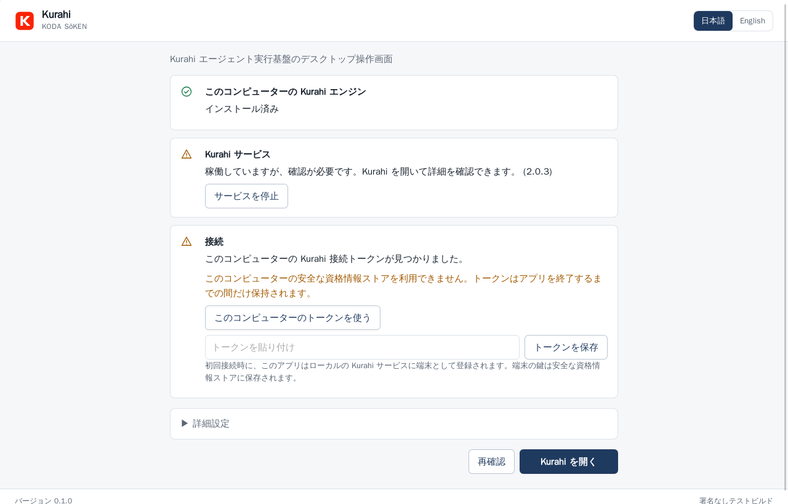
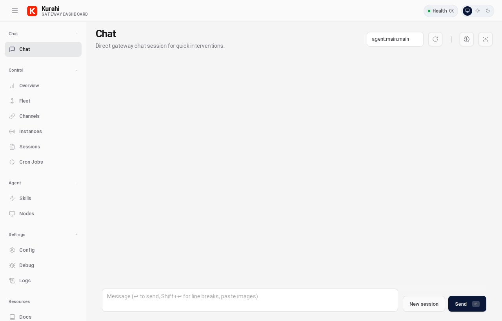
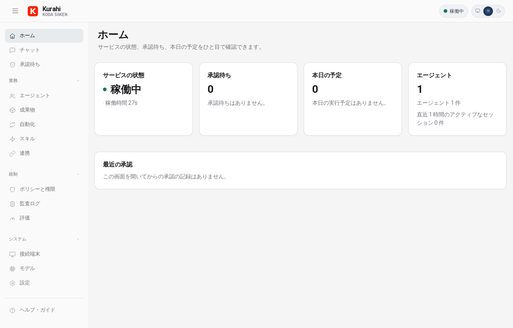
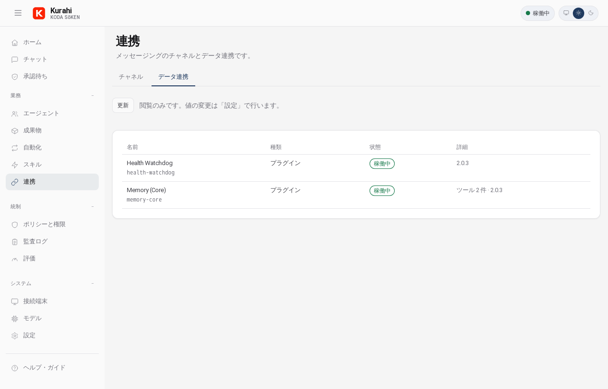
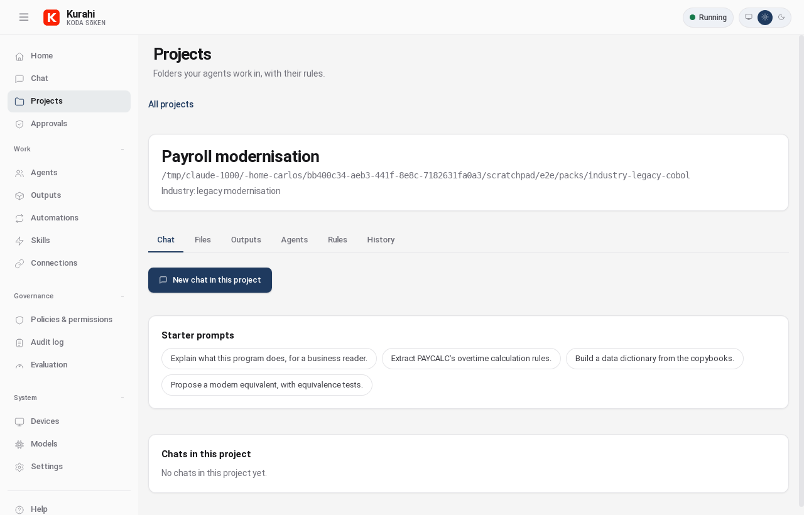

# Kurahi Desktop v0.4

**Unsigned test build.** Code signing is pending (no certificate yet). Every artifact built from
this folder is an unsigned test build and must not be given to customers.

Kurahi Desktop is the desktop app for Kurahi, by KODA SōKEN. It is a thin Tauri 2 shell (Rust,
system WebView) around the existing Control UI (`ui/`). The engine stays the TypeScript Kurahi
runtime; the app only talks to the Kurahi gateway on this computer.



## What it does

- **Bundled Control UI.** `ui/src` is built into the app. No remote URL; it works offline.
- **Loopback only.** The gateway address defaults to `ws://127.0.0.1:18789`
  (`DEFAULT_GATEWAY_PORT`). It can be changed under Advanced, but only to `127.0.0.1`,
  `localhost` or `::1` (no credentials, path, query or TLS in v0.1).
- **Tray icon** with the gateway health from `GET /health`: green (`healthy`), amber (`degraded`
  or an unexpected answer), red (`unhealthy` / HTTP 503, or nothing listening). Menu: status line,
  Open, Start service, Stop service, Quit. Closing the window keeps the app in the tray.
- **Start / stop** run the Kurahi CLI with fixed arguments only:
  `kurahi service start --json`, `kurahi service stop --json` (`src/cli/service-cli.ts`). The CLI
  is found on `PATH` (absolute entries only) or through `KURAHI_CLI` (an absolute file path set by
  an installer or administrator).
- **First-run screen** (`web/index.html`): checks whether the engine is installed and the service
  is running, explains the next step in Japanese and English, and connects with this computer's
  gateway token (`<KOLO_HOME>/secrets/gateway.token`) or a pasted token. On loopback, the
  Control UI's device identity is paired silently by the gateway (`ui/src/ui/gateway.ts`,
  `device-identity.ts`, `device-auth.ts`). When running and a token is stored, it opens the
  Control UI directly.
- **Japanese and English.** The OS locale decides; the 日本語 | English switch overrides it.
  The text lives in a catalogue keyed by message ID (`web/i18n.ts`), so more locales can be added
  after native review. The tray follows the switch.
- **Branding.** Product "Kurahi", publisher "KODA SōKEN", identifier `com.kodasoken.kurahi`,
  window title "Kurahi", light mode, SVG icons from the Kurahi mark
  (`docs/assets/kolo-mark.svg`). No AI vendor or model names in the app, installer metadata or
  bundle text.



## Security model

### Capabilities (`src-tauri/capabilities/main.json`)

The main window gets the app's own commands and nothing else: no core plugin defaults, no
shell, fs, http, opener, dialog or updater permission.

```
allow-desktop-status       health probe + install/token detection (no secrets returned)
allow-set-gateway-url      validated loopback URL only, saved to desktop.json
allow-service-control      enum start | stop | status -> fixed CLI argv
allow-import-local-token   reads <KOLO_HOME>/secrets/gateway.token into the keychain; returns no token
allow-set-language         enum ja | en for the tray text
allow-secret-get-all       the four allow-listed UI secret keys
allow-secret-set           allow-listed key, value <= 8 KiB
allow-secret-delete        allow-listed key
allow-audit-fetch          GET /api/admin/audit on the loopback gateway (fixed path, whitelisted params)
```

`build.rs` declares the commands in the app manifest, so a command without a permission in the
capability cannot be invoked.

### CSP (`src-tauri/tauri.conf.json`)

```
default-src 'self';
script-src 'self';
style-src 'self' 'unsafe-inline';
img-src 'self' data: blob:;
font-src 'self' data:;
connect-src 'self' ipc: http://ipc.localhost http://127.0.0.1:* ws://127.0.0.1:* http://localhost:* ws://localhost:* http://[::1]:* ws://[::1]:*;
object-src 'none'; base-uri 'self'; form-action 'none'; frame-src 'none'; frame-ancestors 'none'
```

No `unsafe-eval`; scripts only from the bundle. `style-src 'unsafe-inline'` is needed because Lit
writes inline `style` attributes, and `dangerousDisableAssetCspModification: ["style-src"]` stops
Tauri from adding hashes that would switch it off. The Control UI's Google Fonts `@import` is
stripped from the desktop bundle at build time (`vite.config.ts`), so nothing remote loads.
`freezePrototype` is on; `withGlobalTauri` is off.

### Tokens and keys

The browser Control UI keeps four secrets in `localStorage`: the gateway token
(inside `KoLo.control.settings.v1`), device-auth tokens (`KoLo.device.auth.v1`), the Ed25519
device identity including its private key (`kolo-device-identity-v1`) and the pairing credential
(`kolo-pair-credential-v1`).

In the desktop build none of them touch `localStorage`:

- `ui/src/ui/secret-storage.ts` (new, small) routes those four keys through a pluggable backend.
  The browser build keeps `localStorage`, unchanged.
- `web/control.ts` installs a keychain backend before the Control UI loads. Values are preloaded
  from the OS keychain (`secret_get_all`) and every change is written through in order.
- `ui/src/ui/storage.ts` keeps the token out of the settings JSON when a host store is installed
  and moves a token left there by an older build.
- Rust stores them with the `keyring` crate under service `com.kodasoken.kurahi`:
  Windows Credential Manager, macOS Keychain, Linux Secret Service.
- If no keychain is reachable (for example WSL without a Secret Service), secrets live in
  process memory only, the first-run screen says so, and they are lost on quit. They are never
  written to a plain file.

`desktop.json` (app config directory) holds only the gateway URL.

### Other

- No shell, no generic process API. The CLI runs with a fixed argv, stdin closed, output capped at
  16 KiB, 60 s timeout, no console window on Windows.
- The health probe is a minimal HTTP/1.1 GET over `std::net` to a literal loopback address
  (`localhost` is pinned to 127.0.0.1, never resolved), 64 KiB response cap, short timeouts.
- No telemetry, no crash reporter.
- **Updater: disabled.** No updater plugin is compiled in and `createUpdaterArtifacts` is false.
  A signing keypair was generated with `tauri signer generate`; the private key and its password
  are in the vault (`~/.kolo/vault/kurahi-desktop-updater.key`, `.pass`, mode 600) and are not in
  the repository. The public key is `src-tauri/updater/kurahi-desktop-updater.pub`. Enable the
  updater only once there is a release channel.

## Build

Prerequisites (Linux / WSL): Rust stable, Node 22, and Tauri's Linux packages
(`libwebkit2gtk-4.1-dev build-essential libssl-dev libayatana-appindicator3-dev librsvg2-dev
libxdo-dev curl wget file`).

```bash
cd ui && npm ci && cd ..                # Control UI dependencies (ui/package-lock.json)
cd apps/desktop
npm ci
npm test                                # vitest: web/*.test.ts
(cd src-tauri && cargo test)            # Rust unit tests
npx tauri build --bundles deb,appimage  # runs `npm run build:web` first
```

Artifacts: `src-tauri/target/release/bundle/deb/Kurahi_0.5.0_amd64.deb` and
`src-tauri/target/release/bundle/appimage/Kurahi_0.5.0_amd64.AppImage`.

Windows: see [WINDOWS_BUILD.md](WINDOWS_BUILD.md); Microsoft Store (MSIX, cross-built on Linux): `scripts/build-msix.sh`. macOS: `npx tauri build --bundles app,dmg` on
a Mac (not yet tried).

Icons: `npm run icons` regenerates `src-tauri/icons/` from `assets/*.svg`.

## Layout

```
apps/desktop/
  web/index.html, boot.ts, boot.css, i18n.ts   first-run screen
  web/control.html, control.ts                 Control UI entry with keychain storage
  web/keychain-storage.ts, desktop-api.ts      keychain backend, typed command wrappers
  src-tauri/src/lib.rs                         commands, tray, health poller
  src-tauri/src/{gateway_url,health,cli,secrets,config,i18n}.rs
  src-tauri/capabilities/main.json             the only capability
  src-tauri/tauri.conf.json                    CSP, bundle metadata
```

Changes outside `apps/desktop`: `ui/src/ui/secret-storage.ts` (new), and `storage.ts`,
`device-auth.ts`, `device-identity.ts`, `pair-link.ts` now read and write secrets through it;
`ui/vitest.node.config.ts` runs the non-browser UI tests in Node (the default UI config needs
Playwright Chromium).

## Testing against a disposable gateway

Never use a gateway you rely on or `~/.kolo`. Start a throwaway gateway from this worktree with its
own state root, a spare port and **Bonjour/mDNS advertising off**, in the foreground with a
timeout, and stop it afterwards:

```bash
export KOLO_HOME="$(mktemp -d)"            # throwaway state root
export KOLO_DISABLE_BONJOUR=1              # no mDNS/Bonjour advertisement (src/infra/bonjour.ts)
echo '{"gateway":{"mode":"local","bind":"loopback"},"discovery":{"mdns":{"mode":"off"}}}' > "$KOLO_HOME/kolo.json"
timeout 120 node kolo.mjs gateway --port 18871 --bind loopback --allow-unconfigured
```

`discovery.mdns.mode: "off"` in the config and `KOLO_DISABLE_BONJOUR=1` each switch the
advertisement off; set both. Point the app at it with Advanced > gateway address
`ws://127.0.0.1:18871` (or `desktop.json`), and use `KOLO_HOME` so "Use this computer's token"
reads the throwaway token. The v0.1/v0.2 screenshots were taken this way under Xvfb.

## Done in v0.1

- Tauri 2 shell, bundled Control UI, loopback-only gateway URL
- Tray with live health and start/stop through the CLI
- First-run screen (install, service, token), Japanese and English
- Secrets in the OS keychain, memory fallback, never localStorage
- Minimal capability and strict CSP; updater keys generated, updater off
- Linux deb and AppImage; tested against a disposable gateway on port 18871

## Done in v0.2: the enterprise sidebar (Control UI, browser and desktop)



Sidebar (Japanese labels shown, English when the language is English):

| Group | Pages |
| --- | --- |
| (top) | ホーム Home (new dashboard) · チャット Chat · 承認待ち Approvals (new, count badge) |
| 業務 Work | エージェント Agents (fleet + sessions) · 成果物 Outputs · 自動化 Automations (cron) · スキル Skills · 連携 Connections (チャネル Channels + データ連携 Connectors) |
| 統制 Governance | ポリシーと権限 Policies & permissions (read-only) · 監査ログ Audit log (search, CSV) · 評価 Evaluation (placeholder, v0.3) |
| システム System | 接続端末 Devices (instances + nodes) · モデル Models (read-only) · 設定 Settings (configuration, connection, logs, debug) |
| (bottom) | ヘルプ・ガイド Help (placeholder) · 日本語 \| English |

- **Header:** Kurahi mark, "KODA SōKEN", live status 稼働中 / 停止 / 要確認.
- **Old URLs redirect:** `/overview`→`/home`, `/fleet`→`/agents`, `/sessions`→`/agents/sessions`,
  `/cron` and `/schedules`→`/automations`, `/channels`→`/connections`, `/instances`→`/devices`,
  `/nodes`→`/devices/nodes`, `/config`→`/settings`, `/debug`→`/settings/debug`,
  `/logs`→`/settings/logs` (`ui/src/ui/navigation.ts`, `LEGACY_PATHS`).
- **Role filter:** one function, `visiblePages(audience)`. The audience comes from the
  connect-time auth: `operator.admin` scope = admin (everything), any other credential = business
  user (Home, Chat, Projects, Approvals, Help), no auth info = unknown (everything). A business user who
  opens a hidden page lands on Home.
- **Approvals:** the live `exec.approval.requested` queue with allow once / always / deny. The
  gateway has no API to list requests made before the window connected; the page says so.
- **Connectors:** a read-only catalogue starts with Microsoft 365, Gmail and Microsoft Entra ID,
  then safely named runtime rows from `plugins.list`, `mcp.status` and configuration. Status words:
  稼働中 Active requires explicit current health or connection evidence, 未検証 Configured, not
  verified means related runtime or configuration exists without a connector-specific probe,
  無効 Disabled means explicitly switched off, and 計画中 Planned means no implementation evidence
  exists. Targets, hosts, paths, keys, headers and raw errors are never shown.
- **Policies:** `auth.isolation`, `auth.grants`, the exec approval rules file and `policy.status`,
  read-only. Editing stays in Settings.
- **Audit log:** the service log (`logs.tail`) with text and level filters, or audit events from
  `/api/admin/audit`. In the browser build that is a same-origin fetch. In Kurahi Desktop the
  webview is another origin and the gateway's CORS policy stays closed, so the page calls the
  `audit_fetch` command instead (`src-tauri/src/audit.rs`): the loopback URL from the validated
  desktop config, the fixed path `/api/admin/audit`, only the gateway's `AuditQuery` parameters
  (validated, unknown ones refused), the token from the app's secret store, 2 MiB response cap.
  CSV export with a UTF-8 BOM and spreadsheet-formula neutralisation.
- **Models:** providers exactly as `models.providers` and `agents.defaults.model` name them, and
  where they run (this computer when the base URL is loopback, else the host name). Nothing is
  hard-coded and no key is read.
- **Skills:** risk-level and approval-required columns are a TODO in `views/skills.ts`; skill
  metadata has no such fields yet, so nothing is invented.
- **Languages:** `ui/src/ui/i18n/` is a catalogue keyed by message ID for any number of locales.
  The user's choice (sidebar switch, or Settings > Language, which also offers Automatic) wins,
  then the organisation default `gateway.controlUi.defaultLocale` (new config key), then the OS
  locale. Only `ja` and `en` ship; additional locales remain planned after native review. The font
  stack puts Noto Sans JP / SC / KR first (installed fonts only), and the
  sidebar wraps long labels so text 40% longer than English still fits.
- **Look:** light mode by default, deep-navy accent `#1F3A5F` through the existing `--accent`
  variables, thin SVG line icons in `icons.ts`, no emojis.



Tests include `navigation.test.ts`, `i18n/i18n.test.ts`, `controllers/connectors.test.ts`,
`controllers/projects.test.ts`, `controllers/artifact-export.test.ts`, `controllers/v03.test.ts`,
`controllers/enterprise.test.ts` and `app-settings.guard.test.ts` in Node
(`ui/vitest.node.config.ts`).
`navigation.browser.test.ts` was updated (new paths, redirects, sidebar order, badge) but needs
Playwright Chromium, which hangs WSL, so it was not run here; the other browser-only suites were
skipped for the same reason.

## Done in v0.3: projects, outputs and a working chat

Demo script: [DEMO.md](DEMO.md) (`scripts/demo-gateway.sh`, `scripts/demo-app.sh`).



- **Projects** (`src/projects/`, gateway methods `projects.*`): a project root folder is its
  permission boundary, alongside allowed agents, rules, starter prompts and a terminal profile
  (data only, v0.4). Active projects are ordered by recent activity; archived projects are hidden
  by default and available through an explicit toggle. Stored under the Kurahi state dir.
  Create / update / archive are admin-only.
- **Scope enforcement** reuses the tool permission guard (`src/agents/permissions.ts`): in a
  project session (`agent:<id>:proj-<projectId>-<chat>`) read, write and exec are
  deny-by-default; reads are allowed only in the project folder and its data area, writes only
  in the writable folders, exec never. `_answer-keys` folders are unreachable and cannot be
  project folders. chat.send refuses agents the project does not allow and gives the agent the
  project's rules with each message (hidden from history).
- **Templates are data** (`templates/projects/*.json`, `terminal-profiles.json`): Industry
  legacy modernisation, Research & academic, Professional, Education. Each sets folders, rules,
  suggested agents, starter prompts, a terminal profile and the demo pack folder. Override the
  directory with `KURAHI_PROJECT_TEMPLATES_DIR`. (They live with the gateway, not under
  `apps/desktop/`, because the gateway applies them and the browser build uses them too.)
- **Chat history panel**: conversations grouped by project, search by title and by transcript
  text, new chat, rename (admin), archive.
- **Document upload**: PDF, XLSX, DOCX, CSV, TXT, MD and images; 20 MB; type checked by magic
  bytes; chunked over the WebSocket; stored in the project's attachments area or a per-user
  scratch area; text extracted on the gateway and sent to the agent with the message; every
  upload (and refusal) in the audit log.
- **Outputs (成果物)**: "Save as output" on a reply; versions with SHA-256; 下書き → 確認中 →
  承認済み with the author unable to approve their own version when people can be told apart;
  side panel with versions, diff and history. Markdown export hashes the exact UTF-8 download and
  produces a matching `.sha256` sidecar; the UI labels the stored-content hash separately from the
  export-file hash. PDF is not available in v0.3. The Outputs page filters by project and status.
- **Agent / model picker** in the chat box, limited to the project's agents and the
  configured models (model choice is admin-only, through sessions.patch).
- **Approvals in the chat**: approval requests for the open conversation appear as cards in it,
  using the same `exec.approval.resolve` as 承認待ち; decisions are audited.

Screenshots: `docs/screenshot-chat-en.png`, `docs/screenshot-chat-ja.png`,
`docs/screenshot-projects-en.png`, `docs/screenshot-project-en.png`,
`docs/screenshot-project-rules-en.png`, `docs/screenshot-project-files-en.png`,
`docs/screenshot-history-panel-en.png`, `docs/screenshot-artifact-panel-en.png`,
`docs/screenshot-inline-approval-en.png`, `docs/screenshot-outputs-en.png`.

## Done in v0.4: the Industrial Edition (with Kurahi 2.1.0)

- Industrial workbench: modernisation Projects backed by the legacy analyser (COBOL/JCL, Java,
  SQL DDL, FORTRAN, PL/I), 設計書 and wave plan outputs, capability packs
  (see `INDUSTRIAL_EDITION.md` and `docs/industrial-modernisation.md`).
- Work Console: the Project terminal goes through the gateway broker (line approvals, diffs,
  audit, read-only folders); push-to-talk voice with transcript review.
- Business preview: read-only work queue review; connector catalogue shows Active only after a
  live probe.
- Windows: the x64 exe cross-compiles from Linux (`WINDOWS_BUILD.md`) and an unsigned Store MSIX
  is built from it (`scripts/build-msix.sh`).

## Next

- Code signing (Windows Authenticode, Apple Developer ID), then the updater with a release channel
- Windows MSI/NSIS on a build machine without the ASR block (WINDOWS_BUILD.md)
- macOS build and Keychain test
- Verify Linux Secret Service storage on a desktop session with a keyring
- Installer option to install the Kurahi engine and service together
- Native-reviewed locales beyond ja and en

---

## 日本語(概要)

**署名なしテストビルドです。** コード署名証明書がまだないため、ここで作成したビルドはすべて
署名なしのテスト版です。お客様には配布しないでください。

Kurahi Desktop は KODA SōKEN の Kurahi 用デスクトップアプリです。Tauri 2 の薄いシェルに既存の
Control UI を同梱し、このコンピューター上の Kurahi ゲートウェイ(ループバックのみ)に接続します。

- タスクトレイに稼働状態(緑・黄・赤)を表示し、開く/サービス開始/サービス停止/終了を操作できます。
  開始・停止は `kurahi service start|stop --json` を固定引数で実行するだけです。
- 初回画面でエンジンのインストール有無・サービス稼働・接続トークンを確認し、次の手順を日本語と
  英語で案内します。表示言語は OS に従い、日本語 | English で切り替えられます。
- 接続トークン・端末の鍵は OS の資格情報ストア(Windows 資格情報マネージャー、macOS
  キーチェーン)に保存し、localStorage やファイルには保存しません。
- 権限はアプリ独自のコマンドのみ。シェル・ファイル・HTTP プラグインは使いません。CSP は
  `default-src 'self'`、接続先はループバックのみです。
- テレメトリーはありません。自動更新は無効です(署名鍵は生成済み、公開鍵のみリポジトリに保存)。

### Industrial terminal workbench

The Industrial Project page now exposes Terminal beside its other project views. Open a
project-bound session, send one line at a time, stop the current command, or explicitly close
the session. The gateway enforces the project mode, permissions, and approval policy; Read
mode cannot open or submit terminal input. Terminal approvals offer Allow once / Deny.

This is a text transcript, not an interactive screen emulator. It displays command exit and
file-diff summaries, strips terminal escape actions, and retains bounded output. One session
is retained in browser memory; return to its project to close it before opening another.
A page reload loses that local handle (the broker's idle timeout still applies).

Disconnect disables input without claiming commands stopped. Reconnect replays missed output
and approvals. Uncertain commands are never resent automatically. A definitive missing-session
response after a gateway restart allows a fresh session. The workbench completion metric reads
“Not yet measured” until signed timeline measurements are connected. Voice capture remains unavailable until the native bridge is installed.

### Industrial voice draft adapter

The UI now implements the gateway voice session and transcript review flow in Japanese and
English. This build **does not capture microphone audio**: the Tauri capture bridge is not yet
implemented, and the UI displays an unavailable state. Protocol method presence is not proof
that an engine is enabled. No browser microphone permission is requested.

The native integration must install `KoLoApp.voiceCapture`, a factory returning an independent
`VoiceCapture` handle (`ui/src/ui/controllers/voice.ts`). `start(write, failed)` starts native
capture and delivers raw base64 PCM16 little-endian, mono, 16 kHz; await each `write` for
backpressure. `stop()` flushes the final chunk before resolving. `cancel()` must synchronously
stop/release capture, be idempotent, discard buffers, and remain effective if called during
pending startup. Each handle owns its own resources: cancelling an old handle must never stop
a new one. Report native errors through `failed`; do not log audio or transcripts.

The controller serializes audio requests, stops on failed delivery, and cancels on disconnect,
project/view navigation, component removal or Discard. Reconnect never resumes capture.
Final events and stop responses are deduplicated, including late errors after a final result.
Voice events bypass the debug event history. Transcripts remain in memory for review; the
explicit **Open as chat draft** action opens the ordinary composer and never sends or approves.
Stale draft transitions after navigation, editing or disconnect are discarded.

`node ui/visual/capture-industrial.mjs` captures workbench, terminal and voice-review fixtures
at desktop/mobile sizes. All fixture transcripts and plant data are fictional; voice-review
captures illustrate the UI only, with no microphone or gateway attached.
