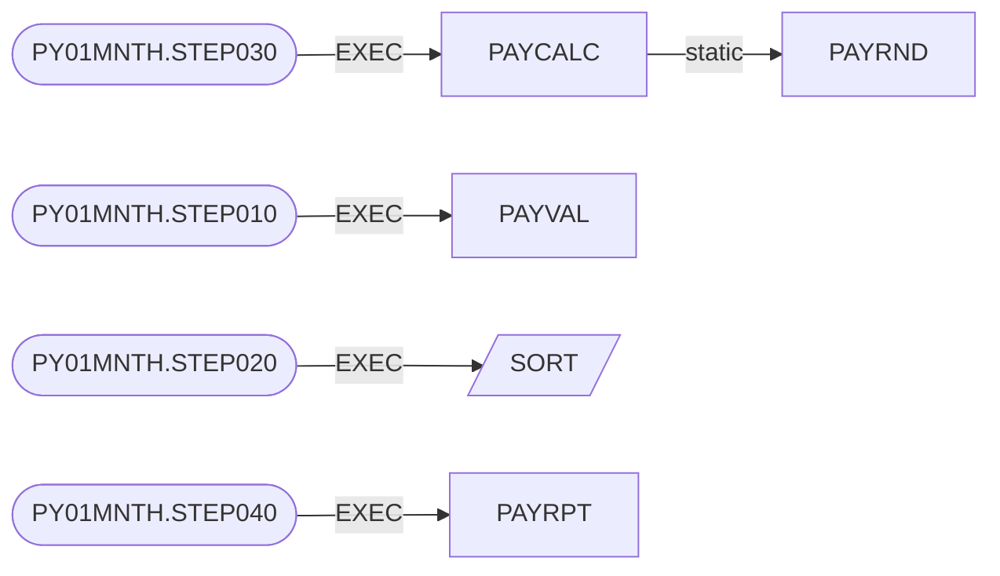
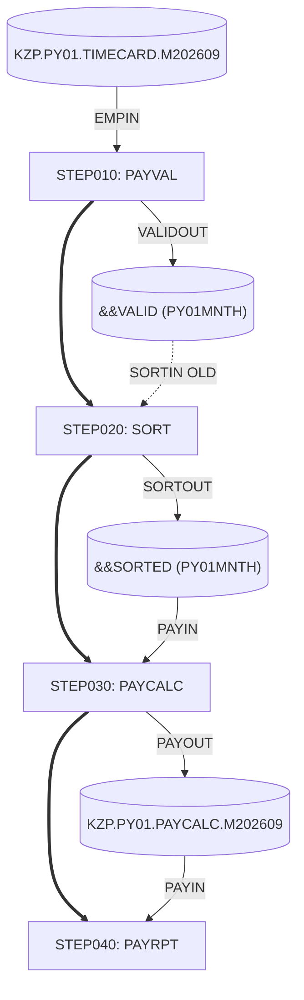

# Design document (generated from code): industry-legacy-cobol

> Every statement in this document is extracted deterministically from the source code. The `path:line` on each line is the source location it comes from. What code cannot tell, such as business intent, is marked "needs confirmation" for a person to fill in.
>
> Source: 7 files analysed, source fingerprint sha256:5786adeb80741427.

## Contents

1. System overview
2. Job flow
3. Program specifications
4. Data dictionary
5. CRUD matrix
6. Coverage and open questions

## 1. System overview

### 1.1 Inventory

| Kind | Name | File | Lines | Source |
| --- | --- | --- | --- | --- |
| COBOL program | PAYCALC | source/cobol/PAYCALC.cbl | 215 | `source/cobol/PAYCALC.cbl:1` |
| COBOL program | PAYRND | source/cobol/PAYRND.cbl | 64 | `source/cobol/PAYRND.cbl:1` |
| COBOL program | PAYRPT | source/cobol/PAYRPT.cbl | 315 | `source/cobol/PAYRPT.cbl:1` |
| COBOL program | PAYVAL | source/cobol/PAYVAL.cbl | 178 | `source/cobol/PAYVAL.cbl:1` |
| Copybook | EMPREC | source/copybook/EMPREC.cpy | 46 | `source/copybook/EMPREC.cpy:1` |
| Copybook | PAYREC | source/copybook/PAYREC.cpy | 33 | `source/copybook/PAYREC.cpy:1` |
| JCL job | PY01MNTH | source/jcl/PY01MNTH.jcl | 49 | `source/jcl/PY01MNTH.jcl:1` |

Totals of the table above and the graph: programs 4, copybooks 2, jobs/procedures 1, job steps 4, paragraphs 33, statements 314, called or executed programs without source 1.

### 1.2 Program relationships

> Solid arrows: static CALL or step EXEC. Dashed: dynamic CALL (target is a data item). Parallelogram boxes: programs without source or dynamic targets. Each arrow is listed with its source lines in the next table.

### 1.3 Relationships with sources

| From | Relation | To | Occurrences | Source |
| --- | --- | --- | --- | --- |
| PAYCALC | CALL (static) | PAYRND | 9 | `source/cobol/PAYCALC.cbl:140` `source/cobol/PAYCALC.cbl:147` `source/cobol/PAYCALC.cbl:155` `source/cobol/PAYCALC.cbl:158` `source/cobol/PAYCALC.cbl:161` `source/cobol/PAYCALC.cbl:178` +3 |
| PY01MNTH.STEP010 | EXEC (step runs program) | PAYVAL | 1 | `source/jcl/PY01MNTH.jcl:17` |
| PY01MNTH.STEP020 | EXEC (step runs program) | SORT | 1 | `source/jcl/PY01MNTH.jcl:25` |
| PY01MNTH.STEP030 | EXEC (step runs program) | PAYCALC | 1 | `source/jcl/PY01MNTH.jcl:35` |
| PY01MNTH.STEP040 | EXEC (step runs program) | PAYRPT | 1 | `source/jcl/PY01MNTH.jcl:44` |

## 2. Job flow

### 2.1 JCL job PY01MNTH (`source/jcl/PY01MNTH.jcl:1`)

| Symbol | Value | Source |
| --- | --- | --- |
| `PERIOD` | `202609` | `source/jcl/PY01MNTH.jcl:14` |

| # | Step | Program | PARM | COND | Source |
| --- | --- | --- | --- | --- | --- |
| 1 | STEP010 | PAYVAL |  |  | `source/jcl/PY01MNTH.jcl:17` |
| 2 | STEP020 | SORT (no source) |  | `(8,LE,STEP010)` | `source/jcl/PY01MNTH.jcl:25` |
| 3 | STEP030 | PAYCALC | `202609` | `((8,LE,STEP010),(0,NE,STEP020))` | `source/jcl/PY01MNTH.jcl:35` |
| 4 | STEP040 | PAYRPT | `202609` | `((8,LE,STEP010),(0,NE,STEP030))` | `source/jcl/PY01MNTH.jcl:44` |

| Step | DD | Data set | DISP | Access (from DISP) | Program file (SELECT) | Source |
| --- | --- | --- | --- | --- | --- | --- |
| STEP010 | EMPIN | `KZP.PY01.TIMECARD.M202609` | `SHR` | input (SHR) | PAYVAL.EMP-IN | `source/jcl/PY01MNTH.jcl:18` |
| STEP010 | VALIDOUT | `&&VALID (PY01MNTH)` | `(NEW,PASS)` | output (NEW/MOD) | PAYVAL.VALID-OUT | `source/jcl/PY01MNTH.jcl:19` |
| STEP010 | ERRRPT | `SYSOUT=*` |  | SYSOUT | PAYVAL.ERR-RPT | `source/jcl/PY01MNTH.jcl:22` |
| STEP010 | SYSOUT | `SYSOUT=*` |  | SYSOUT |  | `source/jcl/PY01MNTH.jcl:23` |
| STEP020 | SORTIN | `&&VALID (PY01MNTH)` | `(OLD,DELETE)` | exclusive (OLD) |  | `source/jcl/PY01MNTH.jcl:26` |
| STEP020 | SORTOUT | `&&SORTED (PY01MNTH)` | `(NEW,PASS)` | output (NEW/MOD) |  | `source/jcl/PY01MNTH.jcl:27` |
| STEP020 | SYSOUT | `SYSOUT=*` |  | SYSOUT |  | `source/jcl/PY01MNTH.jcl:30` |
| STEP020 | SYSIN |  |  | in-stream |  | `source/jcl/PY01MNTH.jcl:31` |
| STEP030 | PAYIN | `&&SORTED (PY01MNTH)` | `(OLD,PASS)` | exclusive (OLD) | PAYCALC.PAY-IN | `source/jcl/PY01MNTH.jcl:37` |
| STEP030 | PAYOUT | `KZP.PY01.PAYCALC.M202609` | `(NEW,CATLG,DELETE)` | output (NEW/MOD) | PAYCALC.PAY-OUT | `source/jcl/PY01MNTH.jcl:38` |
| STEP030 | SYSOUT | `SYSOUT=*` |  | SYSOUT |  | `source/jcl/PY01MNTH.jcl:42` |
| STEP040 | PAYIN | `KZP.PY01.PAYCALC.M202609` | `SHR` | input (SHR) | PAYRPT.PAY-IN | `source/jcl/PY01MNTH.jcl:46` |
| STEP040 | RPTOUT | `SYSOUT=(A,,PY01)` |  | SYSOUT | PAYRPT.RPT-OUT | `source/jcl/PY01MNTH.jcl:47` |
| STEP040 | SYSOUT | `SYSOUT=*` |  | SYSOUT |  | `source/jcl/PY01MNTH.jcl:48` |

### 2.2 Data set lineage

| Data set | Written by (C/U/D) | Read by (R/?) | Source |
| --- | --- | --- | --- |
| `KZP.PY01.PAYCALC.M202609` | PAYCALC (C) | PAYRPT (R) | `source/cobol/PAYCALC.cbl:124` `source/cobol/PAYRPT.cbl:313` `source/jcl/PY01MNTH.jcl:38` `source/jcl/PY01MNTH.jcl:46` |
| `KZP.PY01.TIMECARD.M202609` | - | PAYVAL (R) | `source/cobol/PAYVAL.cbl:159` `source/jcl/PY01MNTH.jcl:18` |
| `&&SORTED (PY01MNTH)` | SORT (C) | PAYCALC (R) | `source/cobol/PAYCALC.cbl:208` `source/jcl/PY01MNTH.jcl:27` `source/jcl/PY01MNTH.jcl:37` |
| `&&VALID (PY01MNTH)` | PAYVAL (C) | SORT (?) | `source/cobol/PAYVAL.cbl:94` `source/jcl/PY01MNTH.jcl:19` `source/jcl/PY01MNTH.jcl:26` |

> Temporary data sets (&&NAME) are scoped to their job. "?" means a step without program source opens the data set with DISP=OLD: read or rewrite cannot be told from JCL.

## 3. Program specifications

### 3.1 PAYCALC

#### 3.1.1 Basic information

| Item | Content | Source |
| --- | --- | --- |
| PROGRAM-ID | `PAYCALC` | `source/cobol/PAYCALC.cbl:1` |
| Source | source/cobol/PAYCALC.cbl (lines 1-215) | `source/cobol/PAYCALC.cbl:1` |
| Paragraphs / statements / data items | 9 / 92 / 71 | `source/cobol/PAYCALC.cbl:81` |
| Run by job step | PY01MNTH.STEP030 | `source/jcl/PY01MNTH.jcl:35` |

#### 3.1.2 Purpose

- Business purpose: **needs confirmation**. It cannot be derived from code; a person who knows the system must state it. `source/cobol/PAYCALC.cbl:1`

> Header comment of the source, quoted as written (not verified; comments may be out of date):
>
> `source/cobol/PAYCALC.cbl:5` KAZANAMI PRECISION WORKS (FICTIONAL - DEMO ONLY)  
> `source/cobol/PAYCALC.cbl:6` PAYCALC - STEP030 OF JOB PY01MNTH. CALCULATES MONTHLY GROSS  
> `source/cobol/PAYCALC.cbl:7` PAY WITH OVERTIME, HOLIDAY AND NIGHT PREMIUMS UNDER  
> `source/cobol/PAYCALC.cbl:8` LABOUR STANDARDS ACT (LSA) ART.37.  
> `source/cobol/PAYCALC.cbl:9` PARM    : PAY PERIOD AS YYYYMM (E.G. 202609).  
> `source/cobol/PAYCALC.cbl:10` INPUT   : PAYIN  - VALIDATED EMPREC RECORDS, SORTED DEPT/ID.  
> `source/cobol/PAYCALC.cbl:11` OUTPUT  : PAYOUT - PAYREC RECORDS, SAME ORDER.  

#### 3.1.3 Inputs and outputs

| File (SELECT/FD) | ASSIGN | Organisation | OPEN | Operations | Records | DD → data set | Source |
| --- | --- | --- | --- | --- | --- | --- | --- |
| `PAY-IN` | `PAYIN` | LINE SEQUENTIAL | INPUT | READ | EMP-RECORD | PAYIN → &&SORTED (PY01MNTH) | `source/cobol/PAYCALC.cbl:34` `source/cobol/PAYCALC.cbl:42` `source/cobol/PAYCALC.cbl:100` `source/cobol/PAYCALC.cbl:208` `source/jcl/PY01MNTH.jcl:37` |
| `PAY-OUT` | `PAYOUT` | LINE SEQUENTIAL | OUTPUT | WRITE | PAY-RECORD | PAYOUT → KZP.PY01.PAYCALC.M202609 | `source/cobol/PAYCALC.cbl:37` `source/cobol/PAYCALC.cbl:44` `source/cobol/PAYCALC.cbl:100` `source/cobol/PAYCALC.cbl:124` `source/jcl/PY01MNTH.jcl:38` |

#### 3.1.4 Calls

| Direction | Program | Kind | USING | Paragraph | Source |
| --- | --- | --- | --- | --- | --- |
| calls | `PAYRND` | static | `WS-RND-MODE WS-RND-IN WS-RND-OUT` | `3000-BASE-AND-RATE` | `source/cobol/PAYCALC.cbl:140` `source/cobol/PAYCALC.cbl:147` |
| calls | `PAYRND` | static | `WS-RND-MODE WS-RND-IN WS-RND-OUT` | `4000-ROUND-HOURS` | `source/cobol/PAYCALC.cbl:155` `source/cobol/PAYCALC.cbl:158` `source/cobol/PAYCALC.cbl:161` |
| calls | `PAYRND` | static | `WS-RND-MODE WS-RND-IN WS-RND-OUT` | `5000-PREMIUMS` | `source/cobol/PAYCALC.cbl:178` `source/cobol/PAYCALC.cbl:181` `source/cobol/PAYCALC.cbl:184` `source/cobol/PAYCALC.cbl:189` |

#### 3.1.5 PERFORM structure

- `0000-MAIN` (first paragraph, entry point) `source/cobol/PAYCALC.cbl:82`
  - PERFORM `1000-INITIALISE` `source/cobol/PAYCALC.cbl:83`
    - PERFORM `8000-READ-INPUT` `source/cobol/PAYCALC.cbl:106`
  - PERFORM `2000-PROCESS` `source/cobol/PAYCALC.cbl:84`
    - PERFORM `3000-BASE-AND-RATE` `source/cobol/PAYCALC.cbl:116`
    - PERFORM `4000-ROUND-HOURS` `source/cobol/PAYCALC.cbl:117`
    - PERFORM `5000-PREMIUMS` `source/cobol/PAYCALC.cbl:118`
    - PERFORM `6000-ALERTS` `source/cobol/PAYCALC.cbl:119`
    - PERFORM `8000-READ-INPUT` (expanded above) `source/cobol/PAYCALC.cbl:126`
  - PERFORM `9000-TERMINATE` `source/cobol/PAYCALC.cbl:85`

#### 3.1.6 Business-rule candidates

| ID | Kind | Paragraph | Expression (source text) | Under condition | Named constants | Business meaning | Source |
| --- | --- | --- | --- | --- | --- | --- | --- |
| `PAYCALC-R001` | condition | `1000-INITIALISE` | `IF WS-PARM NOT NUMERIC` |  |  | needs confirmation | `source/cobol/PAYCALC.cbl:90` |
| `PAYCALC-R002` | literal assignment | `1000-INITIALISE` | `MOVE 16 TO RETURN-CODE` | `IF WS-PARM NOT NUMERIC` |  | needs confirmation | `source/cobol/PAYCALC.cbl:92` |
| `PAYCALC-R003` | condition | `1000-INITIALISE` | `IF WS-PERIOD < WS-SME-DEFERRAL-END` |  | WS-SME-DEFERRAL-END=202304 (source/cobol/PAYCALC.cbl:61) | needs confirmation | `source/cobol/PAYCALC.cbl:97` `source/cobol/PAYCALC.cbl:61` |
| `PAYCALC-R004` | literal assignment | `1000-INITIALISE` | `MOVE 1.25 TO WS-OT2-RATE` | `IF WS-PERIOD < WS-SME-DEFERRAL-END` | WS-OT2-RATE=1.50 (source/cobol/PAYCALC.cbl:57) | needs confirmation | `source/cobol/PAYCALC.cbl:98` `source/cobol/PAYCALC.cbl:57` |
| `PAYCALC-R005` | condition | `1000-INITIALISE` | `IF WS-FS-IN NOT = '00'` |  |  | needs confirmation | `source/cobol/PAYCALC.cbl:101` |
| `PAYCALC-R006` | literal assignment | `1000-INITIALISE` | `MOVE 16 TO RETURN-CODE` | `IF WS-FS-IN NOT = '00'` |  | needs confirmation | `source/cobol/PAYCALC.cbl:103` |
| `PAYCALC-R007` | arithmetic | `2000-PROCESS` | `ADD 1 TO WS-READ-CNT` |  |  | needs confirmation | `source/cobol/PAYCALC.cbl:109` |
| `PAYCALC-R008` | arithmetic | `2000-PROCESS` | `COMPUTE PAY-GROSS-AMT = PAY-BASE-AMT + PAY-ALLOW-AMT + PAY-OT1-AMT + PAY-OT2-AMT + PAY-HOL-AMT + PAY-NIGHT-AMT` |  |  | needs confirmation | `source/cobol/PAYCALC.cbl:120` |
| `PAYCALC-R009` | arithmetic | `2000-PROCESS` | `ADD PAY-GROSS-AMT TO WS-GROSS-TOTAL` |  |  | needs confirmation | `source/cobol/PAYCALC.cbl:123` |
| `PAYCALC-R010` | arithmetic | `2000-PROCESS` | `ADD 1 TO WS-WRITE-CNT` |  |  | needs confirmation | `source/cobol/PAYCALC.cbl:125` |
| `PAYCALC-R011` | arithmetic | `3000-BASE-AND-RATE` | `COMPUTE PAY-ALLOW-AMT = EMP-ALLOW-INCL + EMP-ALLOW-EXCL` |  |  | needs confirmation | `source/cobol/PAYCALC.cbl:135` |
| `PAYCALC-R012` | condition | `3000-BASE-AND-RATE` | `IF EMP-PART-TIME` |  |  | needs confirmation | `source/cobol/PAYCALC.cbl:136` |
| `PAYCALC-R013` | arithmetic | `3000-BASE-AND-RATE` | `COMPUTE WS-RND-IN = WS-RATE * EMP-REG-MIN / 60` | `IF EMP-PART-TIME` |  | needs confirmation | `source/cobol/PAYCALC.cbl:138` |
| `PAYCALC-R014` | arithmetic | `3000-BASE-AND-RATE` | `COMPUTE WS-RND-IN = (EMP-BASE-PAY + EMP-ALLOW-INCL) / EMP-SCHED-HRS` | `ELSE OF IF EMP-PART-TIME` |  | needs confirmation | `source/cobol/PAYCALC.cbl:144` |
| `PAYCALC-R015` | condition | `5000-PREMIUMS` | `IF NOT EMP-MANAGER` |  |  | needs confirmation | `source/cobol/PAYCALC.cbl:169` |
| `PAYCALC-R016` | condition | `5000-PREMIUMS` | `IF WS-OT-HRS > WS-OT-TIER-HOURS` | `IF NOT EMP-MANAGER` | WS-OT-TIER-HOURS=060 (source/cobol/PAYCALC.cbl:60) | needs confirmation | `source/cobol/PAYCALC.cbl:170` `source/cobol/PAYCALC.cbl:60` |
| `PAYCALC-R017` | arithmetic | `5000-PREMIUMS` | `COMPUTE PAY-OT2-HRS = WS-OT-HRS - WS-OT-TIER-HOURS` | `IF NOT EMP-MANAGER` `IF WS-OT-HRS > WS-OT-TIER-HOURS` | WS-OT-TIER-HOURS=060 (source/cobol/PAYCALC.cbl:60) | needs confirmation | `source/cobol/PAYCALC.cbl:172` `source/cobol/PAYCALC.cbl:60` |
| `PAYCALC-R018` | arithmetic | `5000-PREMIUMS` | `COMPUTE WS-RND-IN = WS-RATE * PAY-OT1-HRS * WS-OT1-RATE` | `IF NOT EMP-MANAGER` | WS-OT1-RATE=1.25 (source/cobol/PAYCALC.cbl:56) | needs confirmation | `source/cobol/PAYCALC.cbl:177` `source/cobol/PAYCALC.cbl:56` |
| `PAYCALC-R019` | arithmetic | `5000-PREMIUMS` | `COMPUTE WS-RND-IN = WS-RATE * PAY-OT2-HRS * WS-OT2-RATE` | `IF NOT EMP-MANAGER` | WS-OT2-RATE=1.50 (source/cobol/PAYCALC.cbl:57) | needs confirmation | `source/cobol/PAYCALC.cbl:180` `source/cobol/PAYCALC.cbl:57` |
| `PAYCALC-R020` | arithmetic | `5000-PREMIUMS` | `COMPUTE WS-RND-IN = WS-RATE * WS-HOL-HRS * WS-HOL-RATE` | `IF NOT EMP-MANAGER` | WS-HOL-RATE=1.35 (source/cobol/PAYCALC.cbl:58) | needs confirmation | `source/cobol/PAYCALC.cbl:183` `source/cobol/PAYCALC.cbl:58` |
| `PAYCALC-R021` | arithmetic | `5000-PREMIUMS` | `COMPUTE WS-RND-IN = WS-RATE * WS-NIGHT-HRS * WS-NIGHT-RATE` |  | WS-NIGHT-RATE=0.25 (source/cobol/PAYCALC.cbl:59) | needs confirmation | `source/cobol/PAYCALC.cbl:188` `source/cobol/PAYCALC.cbl:59` |
| `PAYCALC-R022` | condition | `6000-ALERTS` | `IF NOT EMP-MANAGER` |  |  | needs confirmation | `source/cobol/PAYCALC.cbl:197` |
| `PAYCALC-R023` | condition | `6000-ALERTS` | `IF EMP-OT-MIN > WS-LIMIT-45H-MIN` | `IF NOT EMP-MANAGER` | WS-LIMIT-45H-MIN=02700 (source/cobol/PAYCALC.cbl:63) | needs confirmation | `source/cobol/PAYCALC.cbl:198` `source/cobol/PAYCALC.cbl:63` |
| `PAYCALC-R024` | arithmetic | `6000-ALERTS` | `COMPUTE WS-OT-HOL-MIN = EMP-OT-MIN + EMP-HOL-MIN` | `IF NOT EMP-MANAGER` |  | needs confirmation | `source/cobol/PAYCALC.cbl:201` |
| `PAYCALC-R025` | condition | `6000-ALERTS` | `IF WS-OT-HOL-MIN >= WS-LIMIT-100H-MIN` | `IF NOT EMP-MANAGER` | WS-LIMIT-100H-MIN=06000 (source/cobol/PAYCALC.cbl:64) | needs confirmation | `source/cobol/PAYCALC.cbl:202` `source/cobol/PAYCALC.cbl:64` |
| `PAYCALC-R026` | condition name (88) |  | `EMP-REGULAR = 'R' (of EMP-TYPE)` |  |  | needs confirmation | `source/copybook/EMPREC.cpy:34` |
| `PAYCALC-R027` | condition name (88) |  | `EMP-PART-TIME = 'P' (of EMP-TYPE)` |  |  | needs confirmation | `source/copybook/EMPREC.cpy:35` |
| `PAYCALC-R028` | condition name (88) |  | `EMP-MANAGER = 'M' (of EMP-TYPE)` |  |  | needs confirmation | `source/copybook/EMPREC.cpy:36` |
| `PAYCALC-R029` | condition name (88) |  | `EMP-TYPE-VALID = 'R' OR 'P' OR 'M' (of EMP-TYPE)` |  |  | needs confirmation | `source/copybook/EMPREC.cpy:37` |
| `PAYCALC-R030` | condition name (88) |  | `PAY-OVER-45H = '*' (of PAY-ALERT-45)` |  |  | needs confirmation | `source/copybook/PAYREC.cpy:30` |
| `PAYCALC-R031` | condition name (88) |  | `PAY-AT-100H = '!' (of PAY-ALERT-100)` |  |  | needs confirmation | `source/copybook/PAYREC.cpy:32` |
| `PAYCALC-R032` | condition name (88) |  | `END-OF-INPUT = 'Y' (of WS-EOF-SW)` |  |  | needs confirmation | `source/cobol/PAYCALC.cbl:51` |
| `PAYCALC-R033` | constant |  | `WS-OT1-RATE VALUE 1.25` |  | WS-OT1-RATE=1.25 (source/cobol/PAYCALC.cbl:56) | needs confirmation | `source/cobol/PAYCALC.cbl:56` `source/cobol/PAYCALC.cbl:56` |
| `PAYCALC-R034` | constant |  | `WS-OT2-RATE VALUE 1.50` |  | WS-OT2-RATE=1.50 (source/cobol/PAYCALC.cbl:57) | needs confirmation | `source/cobol/PAYCALC.cbl:57` `source/cobol/PAYCALC.cbl:57` |
| `PAYCALC-R035` | constant |  | `WS-HOL-RATE VALUE 1.35` |  | WS-HOL-RATE=1.35 (source/cobol/PAYCALC.cbl:58) | needs confirmation | `source/cobol/PAYCALC.cbl:58` `source/cobol/PAYCALC.cbl:58` |
| `PAYCALC-R036` | constant |  | `WS-NIGHT-RATE VALUE 0.25` |  | WS-NIGHT-RATE=0.25 (source/cobol/PAYCALC.cbl:59) | needs confirmation | `source/cobol/PAYCALC.cbl:59` `source/cobol/PAYCALC.cbl:59` |
| `PAYCALC-R037` | constant |  | `WS-OT-TIER-HOURS VALUE 060` |  | WS-OT-TIER-HOURS=060 (source/cobol/PAYCALC.cbl:60) | needs confirmation | `source/cobol/PAYCALC.cbl:60` `source/cobol/PAYCALC.cbl:60` |
| `PAYCALC-R038` | constant |  | `WS-SME-DEFERRAL-END VALUE 202304` |  | WS-SME-DEFERRAL-END=202304 (source/cobol/PAYCALC.cbl:61) | needs confirmation | `source/cobol/PAYCALC.cbl:61` `source/cobol/PAYCALC.cbl:61` |
| `PAYCALC-R039` | constant |  | `WS-LIMIT-45H-MIN VALUE 02700` |  | WS-LIMIT-45H-MIN=02700 (source/cobol/PAYCALC.cbl:63) | needs confirmation | `source/cobol/PAYCALC.cbl:63` `source/cobol/PAYCALC.cbl:63` |
| `PAYCALC-R040` | constant |  | `WS-LIMIT-100H-MIN VALUE 06000` |  | WS-LIMIT-100H-MIN=06000 (source/cobol/PAYCALC.cbl:64) | needs confirmation | `source/cobol/PAYCALC.cbl:64` `source/cobol/PAYCALC.cbl:64` |

> Candidates from the rules engine: exact source text and literal values. Their business meaning needs confirmation by a person.

### 3.2 PAYRND

#### 3.2.1 Basic information

| Item | Content | Source |
| --- | --- | --- |
| PROGRAM-ID | `PAYRND` | `source/cobol/PAYRND.cbl:1` |
| Source | source/cobol/PAYRND.cbl (lines 1-64) | `source/cobol/PAYRND.cbl:1` |
| Paragraphs / statements / data items | 3 / 20 / 8 | `source/cobol/PAYRND.cbl:35` |
| PROCEDURE DIVISION USING | `LK-MODE LK-IN-VALUE LK-OUT-VALUE` | `source/cobol/PAYRND.cbl:35` |

#### 3.2.2 Purpose

- Business purpose: **needs confirmation**. It cannot be derived from code; a person who knows the system must state it. `source/cobol/PAYRND.cbl:1`

> Header comment of the source, quoted as written (not verified; comments may be out of date):
>
> `source/cobol/PAYRND.cbl:5` KAZANAMI PRECISION WORKS (FICTIONAL - DEMO ONLY)  
> `source/cobol/PAYRND.cbl:6` PAYRND - SHARED ROUNDING ROUTINE FOR THE PY01 PAYROLL SYSTEM.  

#### 3.2.3 Inputs and outputs

No file, SQL or CICS I/O found.

#### 3.2.4 Calls

| Direction | Program | Kind | USING | Paragraph | Source |
| --- | --- | --- | --- | --- | --- |
| called by | `PAYCALC` | static |  | `3000-BASE-AND-RATE` | `source/cobol/PAYCALC.cbl:140` `source/cobol/PAYCALC.cbl:147` |
| called by | `PAYCALC` | static |  | `4000-ROUND-HOURS` | `source/cobol/PAYCALC.cbl:155` `source/cobol/PAYCALC.cbl:158` `source/cobol/PAYCALC.cbl:161` |
| called by | `PAYCALC` | static |  | `5000-PREMIUMS` | `source/cobol/PAYCALC.cbl:178` `source/cobol/PAYCALC.cbl:181` `source/cobol/PAYCALC.cbl:184` `source/cobol/PAYCALC.cbl:189` |

#### 3.2.5 PERFORM structure

- `0000-MAIN` (first paragraph, entry point) `source/cobol/PAYRND.cbl:36`
  - PERFORM `1000-ROUND-YEN` `source/cobol/PAYRND.cbl:39`
  - PERFORM `2000-ROUND-HOURS` `source/cobol/PAYRND.cbl:41`

#### 3.2.6 Business-rule candidates

| ID | Kind | Paragraph | Expression (source text) | Under condition | Named constants | Business meaning | Source |
| --- | --- | --- | --- | --- | --- | --- | --- |
| `PAYRND-R001` | condition | `0000-MAIN` | `EVALUATE LK-MODE WHEN 'Y'` | `EVALUATE LK-MODE` |  | needs confirmation | `source/cobol/PAYRND.cbl:38` |
| `PAYRND-R002` | condition | `0000-MAIN` | `EVALUATE LK-MODE WHEN 'H'` | `EVALUATE LK-MODE` |  | needs confirmation | `source/cobol/PAYRND.cbl:40` |
| `PAYRND-R003` | literal assignment | `0000-MAIN` | `MOVE 16 TO RETURN-CODE` | `EVALUATE LK-MODE WHEN OTHER` |  | needs confirmation | `source/cobol/PAYRND.cbl:45` |
| `PAYRND-R004` | arithmetic | `1000-ROUND-YEN` | `COMPUTE WS-FRACTION = LK-IN-VALUE - WS-WHOLE` |  |  | needs confirmation | `source/cobol/PAYRND.cbl:51` |
| `PAYRND-R005` | condition | `1000-ROUND-YEN` | `IF WS-FRACTION >= 0.5` |  |  | needs confirmation | `source/cobol/PAYRND.cbl:52` |
| `PAYRND-R006` | arithmetic | `1000-ROUND-YEN` | `ADD 1 TO WS-WHOLE` | `IF WS-FRACTION >= 0.5` |  | needs confirmation | `source/cobol/PAYRND.cbl:53` |
| `PAYRND-R007` | arithmetic | `2000-ROUND-HOURS` | `DIVIDE WS-MINUTES BY 60 GIVING WS-HOURS REMAINDER WS-REMAINDER` |  |  | needs confirmation | `source/cobol/PAYRND.cbl:59` |
| `PAYRND-R008` | condition | `2000-ROUND-HOURS` | `IF WS-REMAINDER >= 30` |  |  | needs confirmation | `source/cobol/PAYRND.cbl:61` |
| `PAYRND-R009` | arithmetic | `2000-ROUND-HOURS` | `ADD 1 TO WS-HOURS` | `IF WS-REMAINDER >= 30` |  | needs confirmation | `source/cobol/PAYRND.cbl:62` |

> Candidates from the rules engine: exact source text and literal values. Their business meaning needs confirmation by a person.

### 3.3 PAYRPT

#### 3.3.1 Basic information

| Item | Content | Source |
| --- | --- | --- |
| PROGRAM-ID | `PAYRPT` | `source/cobol/PAYRPT.cbl:1` |
| Source | source/cobol/PAYRPT.cbl (lines 1-315) | `source/cobol/PAYRPT.cbl:1` |
| Paragraphs / statements / data items | 13 / 133 / 117 | `source/cobol/PAYRPT.cbl:139` |
| Run by job step | PY01MNTH.STEP040 | `source/jcl/PY01MNTH.jcl:44` |

#### 3.3.2 Purpose

- Business purpose: **needs confirmation**. It cannot be derived from code; a person who knows the system must state it. `source/cobol/PAYRPT.cbl:1`

> Header comment of the source, quoted as written (not verified; comments may be out of date):
>
> `source/cobol/PAYRPT.cbl:5` KAZANAMI PRECISION WORKS (FICTIONAL - DEMO ONLY)  
> `source/cobol/PAYRPT.cbl:6` PAYRPT - STEP040 OF JOB PY01MNTH. PRINTS THE MONTHLY PAYROLL  
> `source/cobol/PAYRPT.cbl:7` REGISTER WITH DEPARTMENT SUBTOTALS, A GRAND TOTAL  
> `source/cobol/PAYRPT.cbl:8` AND THE 36-AGREEMENT ALERT LIST FOR HR.  
> `source/cobol/PAYRPT.cbl:9` PARM    : PAY PERIOD AS YYYYMM.  
> `source/cobol/PAYRPT.cbl:10` INPUT   : PAYIN  - PAYREC RECORDS SORTED BY DEPT/ID.  
> `source/cobol/PAYRPT.cbl:11` OUTPUT  : RPTOUT - 132-COLUMN REPORT.  

#### 3.3.3 Inputs and outputs

| File (SELECT/FD) | ASSIGN | Organisation | OPEN | Operations | Records | DD → data set | Source |
| --- | --- | --- | --- | --- | --- | --- | --- |
| `PAY-IN` | `PAYIN` | LINE SEQUENTIAL | INPUT | READ | PAY-RECORD | PAYIN → KZP.PY01.PAYCALC.M202609 | `source/cobol/PAYRPT.cbl:16` `source/cobol/PAYRPT.cbl:23` `source/cobol/PAYRPT.cbl:157` `source/cobol/PAYRPT.cbl:313` `source/jcl/PY01MNTH.jcl:46` |
| `RPT-OUT` | `RPTOUT` | LINE SEQUENTIAL | OUTPUT | WRITE | RPT-LINE | RPTOUT → SYSOUT | `source/cobol/PAYRPT.cbl:19` `source/cobol/PAYRPT.cbl:25` `source/cobol/PAYRPT.cbl:157` `source/cobol/PAYRPT.cbl:294` `source/cobol/PAYRPT.cbl:302` `source/cobol/PAYRPT.cbl:305` +3 |

#### 3.3.4 Calls

No CALL relations.

#### 3.3.5 PERFORM structure

- `0000-MAIN` (first paragraph, entry point) `source/cobol/PAYRPT.cbl:140`
  - PERFORM `1000-INITIALISE` `source/cobol/PAYRPT.cbl:141`
    - PERFORM `8000-READ-INPUT` `source/cobol/PAYRPT.cbl:163`
  - PERFORM `2000-PROCESS` `source/cobol/PAYRPT.cbl:142`
    - PERFORM `2100-ACCUMULATE` `source/cobol/PAYRPT.cbl:189`
    - PERFORM `2200-SAVE-ALERT` `source/cobol/PAYRPT.cbl:191`
    - PERFORM `3000-DEPT-BREAK` `source/cobol/PAYRPT.cbl:167`
      - PERFORM `3100-FORMAT-TOTAL` `source/cobol/PAYRPT.cbl:224`
      - PERFORM `7000-PRINT-DETAIL` `source/cobol/PAYRPT.cbl:227`
        - PERFORM `7100-PRINT-LINE` `source/cobol/PAYRPT.cbl:291`
        - PERFORM `7200-PAGE-HEADING` `source/cobol/PAYRPT.cbl:288`
      - PERFORM `7100-PRINT-LINE` (expanded above) `source/cobol/PAYRPT.cbl:229`
    - PERFORM `7000-PRINT-DETAIL` (expanded above) `source/cobol/PAYRPT.cbl:188`
    - PERFORM `8000-READ-INPUT` (expanded above) `source/cobol/PAYRPT.cbl:193`
  - PERFORM `3000-DEPT-BREAK` (expanded above) `source/cobol/PAYRPT.cbl:144`
  - PERFORM `4000-GRAND-TOTAL` `source/cobol/PAYRPT.cbl:146`
    - PERFORM `3100-FORMAT-TOTAL` (expanded above) `source/cobol/PAYRPT.cbl:250`
    - PERFORM `7000-PRINT-DETAIL` (expanded above) `source/cobol/PAYRPT.cbl:252`
    - PERFORM `7100-PRINT-LINE` (expanded above) `source/cobol/PAYRPT.cbl:248`
  - PERFORM `5000-ALERT-LIST` `source/cobol/PAYRPT.cbl:147`
    - PERFORM `7100-PRINT-LINE` (expanded above) `source/cobol/PAYRPT.cbl:259`

#### 3.3.6 Business-rule candidates

| ID | Kind | Paragraph | Expression (source text) | Under condition | Named constants | Business meaning | Source |
| --- | --- | --- | --- | --- | --- | --- | --- |
| `PAYRPT-R001` | condition | `0000-MAIN` | `IF WS-PREV-DEPT NOT = SPACES` |  |  | needs confirmation | `source/cobol/PAYRPT.cbl:143` |
| `PAYRPT-R002` | condition | `1000-INITIALISE` | `IF WS-FS-IN NOT = '00'` |  |  | needs confirmation | `source/cobol/PAYRPT.cbl:158` |
| `PAYRPT-R003` | literal assignment | `1000-INITIALISE` | `MOVE 16 TO RETURN-CODE` | `IF WS-FS-IN NOT = '00'` |  | needs confirmation | `source/cobol/PAYRPT.cbl:160` |
| `PAYRPT-R004` | condition | `2000-PROCESS` | `IF PAY-DEPT NOT = WS-PREV-DEPT AND WS-PREV-DEPT NOT = SPACES` |  |  | needs confirmation | `source/cobol/PAYRPT.cbl:166` |
| `PAYRPT-R005` | condition | `2000-PROCESS` | `IF PAY-OVER-45H OR PAY-AT-100H` |  |  | needs confirmation | `source/cobol/PAYRPT.cbl:190` |
| `PAYRPT-R006` | condition | `2100-ACCUMULATE` | `PERFORM VARYING WS-IDX FROM 1 BY 1 UNTIL WS-IDX > 2` |  |  | needs confirmation | `source/cobol/PAYRPT.cbl:196` |
| `PAYRPT-R007` | arithmetic | `2100-ACCUMULATE` | `ADD 1 TO T-COUNT(WS-IDX)` | `PERFORM VARYING WS-IDX FROM 1 BY 1 UNTIL WS-IDX > 2` |  | needs confirmation | `source/cobol/PAYRPT.cbl:197` |
| `PAYRPT-R008` | arithmetic | `2100-ACCUMULATE` | `ADD PAY-BASE-AMT TO T-BASE(WS-IDX)` | `PERFORM VARYING WS-IDX FROM 1 BY 1 UNTIL WS-IDX > 2` |  | needs confirmation | `source/cobol/PAYRPT.cbl:198` |
| `PAYRPT-R009` | arithmetic | `2100-ACCUMULATE` | `ADD PAY-ALLOW-AMT TO T-ALLOW(WS-IDX)` | `PERFORM VARYING WS-IDX FROM 1 BY 1 UNTIL WS-IDX > 2` |  | needs confirmation | `source/cobol/PAYRPT.cbl:199` |
| `PAYRPT-R010` | arithmetic | `2100-ACCUMULATE` | `ADD PAY-OT-HRS TO T-OT-HRS(WS-IDX)` | `PERFORM VARYING WS-IDX FROM 1 BY 1 UNTIL WS-IDX > 2` |  | needs confirmation | `source/cobol/PAYRPT.cbl:200` |
| `PAYRPT-R011` | arithmetic | `2100-ACCUMULATE` | `ADD PAY-OT1-AMT TO T-OT1(WS-IDX)` | `PERFORM VARYING WS-IDX FROM 1 BY 1 UNTIL WS-IDX > 2` |  | needs confirmation | `source/cobol/PAYRPT.cbl:201` |
| `PAYRPT-R012` | arithmetic | `2100-ACCUMULATE` | `ADD PAY-OT2-AMT TO T-OT2(WS-IDX)` | `PERFORM VARYING WS-IDX FROM 1 BY 1 UNTIL WS-IDX > 2` |  | needs confirmation | `source/cobol/PAYRPT.cbl:202` |
| `PAYRPT-R013` | arithmetic | `2100-ACCUMULATE` | `ADD PAY-HOL-HRS TO T-HOL-HRS(WS-IDX)` | `PERFORM VARYING WS-IDX FROM 1 BY 1 UNTIL WS-IDX > 2` |  | needs confirmation | `source/cobol/PAYRPT.cbl:203` |
| `PAYRPT-R014` | arithmetic | `2100-ACCUMULATE` | `ADD PAY-HOL-AMT TO T-HOL(WS-IDX)` | `PERFORM VARYING WS-IDX FROM 1 BY 1 UNTIL WS-IDX > 2` |  | needs confirmation | `source/cobol/PAYRPT.cbl:204` |
| `PAYRPT-R015` | arithmetic | `2100-ACCUMULATE` | `ADD PAY-NIGHT-HRS TO T-NIGHT-HRS(WS-IDX)` | `PERFORM VARYING WS-IDX FROM 1 BY 1 UNTIL WS-IDX > 2` |  | needs confirmation | `source/cobol/PAYRPT.cbl:205` |
| `PAYRPT-R016` | arithmetic | `2100-ACCUMULATE` | `ADD PAY-NIGHT-AMT TO T-NIGHT(WS-IDX)` | `PERFORM VARYING WS-IDX FROM 1 BY 1 UNTIL WS-IDX > 2` |  | needs confirmation | `source/cobol/PAYRPT.cbl:206` |
| `PAYRPT-R017` | arithmetic | `2100-ACCUMULATE` | `ADD PAY-GROSS-AMT TO T-GROSS(WS-IDX)` | `PERFORM VARYING WS-IDX FROM 1 BY 1 UNTIL WS-IDX > 2` |  | needs confirmation | `source/cobol/PAYRPT.cbl:207` |
| `PAYRPT-R018` | condition | `2200-SAVE-ALERT` | `IF WS-ALERT-CNT < 100` |  |  | needs confirmation | `source/cobol/PAYRPT.cbl:211` |
| `PAYRPT-R019` | arithmetic | `2200-SAVE-ALERT` | `ADD 1 TO WS-ALERT-CNT` | `IF WS-ALERT-CNT < 100` |  | needs confirmation | `source/cobol/PAYRPT.cbl:212` |
| `PAYRPT-R020` | literal assignment | `3000-DEPT-BREAK` | `MOVE 1 TO WS-IDX` |  |  | needs confirmation | `source/cobol/PAYRPT.cbl:223` |
| `PAYRPT-R021` | literal assignment | `4000-GRAND-TOTAL` | `MOVE 2 TO WS-IDX` |  |  | needs confirmation | `source/cobol/PAYRPT.cbl:249` |
| `PAYRPT-R022` | condition | `5000-ALERT-LIST` | `IF WS-ALERT-CNT = ZERO` |  |  | needs confirmation | `source/cobol/PAYRPT.cbl:264` |
| `PAYRPT-R023` | condition | `5000-ALERT-LIST` | `PERFORM VARYING WS-IDX FROM 1 BY 1 UNTIL WS-IDX > WS-ALERT-CNT` |  |  | needs confirmation | `source/cobol/PAYRPT.cbl:268` |
| `PAYRPT-R024` | condition | `5000-ALERT-LIST` | `IF AL-100(WS-IDX) = '!'` | `PERFORM VARYING WS-IDX FROM 1 BY 1 UNTIL WS-IDX > WS-ALERT-CNT` |  | needs confirmation | `source/cobol/PAYRPT.cbl:275` |
| `PAYRPT-R025` | condition | `7000-PRINT-DETAIL` | `IF WS-LINE-CNT >= WS-LINES-PER-PAGE` |  | WS-LINE-CNT=99 (source/cobol/PAYRPT.cbl:34); WS-LINES-PER-PAGE=060 (source/cobol/PAYRPT.cbl:36) | needs confirmation | `source/cobol/PAYRPT.cbl:287` `source/cobol/PAYRPT.cbl:34` `source/cobol/PAYRPT.cbl:36` |
| `PAYRPT-R026` | arithmetic | `7100-PRINT-LINE` | `ADD 1 TO WS-LINE-CNT` |  | WS-LINE-CNT=99 (source/cobol/PAYRPT.cbl:34) | needs confirmation | `source/cobol/PAYRPT.cbl:295` `source/cobol/PAYRPT.cbl:34` |
| `PAYRPT-R027` | arithmetic | `7200-PAGE-HEADING` | `ADD 1 TO WS-PAGE-CNT` |  |  | needs confirmation | `source/cobol/PAYRPT.cbl:298` |
| `PAYRPT-R028` | condition | `7200-PAGE-HEADING` | `IF WS-PAGE-CNT > 1` |  |  | needs confirmation | `source/cobol/PAYRPT.cbl:300` |
| `PAYRPT-R029` | literal assignment | `7200-PAGE-HEADING` | `MOVE 3 TO WS-LINE-CNT` |  | WS-LINE-CNT=99 (source/cobol/PAYRPT.cbl:34) | needs confirmation | `source/cobol/PAYRPT.cbl:310` `source/cobol/PAYRPT.cbl:34` |
| `PAYRPT-R030` | condition name (88) |  | `PAY-OVER-45H = '*' (of PAY-ALERT-45)` |  |  | needs confirmation | `source/copybook/PAYREC.cpy:30` |
| `PAYRPT-R031` | condition name (88) |  | `PAY-AT-100H = '!' (of PAY-ALERT-100)` |  |  | needs confirmation | `source/copybook/PAYREC.cpy:32` |
| `PAYRPT-R032` | condition name (88) |  | `END-OF-INPUT = 'Y' (of WS-EOF-SW)` |  |  | needs confirmation | `source/cobol/PAYRPT.cbl:31` |
| `PAYRPT-R033` | constant |  | `WS-LINE-CNT VALUE 99` |  | WS-LINE-CNT=99 (source/cobol/PAYRPT.cbl:34) | needs confirmation | `source/cobol/PAYRPT.cbl:34` `source/cobol/PAYRPT.cbl:34` |
| `PAYRPT-R034` | constant |  | `WS-LINES-PER-PAGE VALUE 060` |  | WS-LINES-PER-PAGE=060 (source/cobol/PAYRPT.cbl:36) | needs confirmation | `source/cobol/PAYRPT.cbl:36` `source/cobol/PAYRPT.cbl:36` |

> Candidates from the rules engine: exact source text and literal values. Their business meaning needs confirmation by a person.

### 3.4 PAYVAL

#### 3.4.1 Basic information

| Item | Content | Source |
| --- | --- | --- |
| PROGRAM-ID | `PAYVAL` | `source/cobol/PAYVAL.cbl:1` |
| Source | source/cobol/PAYVAL.cbl (lines 1-178) | `source/cobol/PAYVAL.cbl:1` |
| Paragraphs / statements / data items | 8 / 69 / 51 | `source/cobol/PAYVAL.cbl:71` |
| Run by job step | PY01MNTH.STEP010 | `source/jcl/PY01MNTH.jcl:17` |

#### 3.4.2 Purpose

- Business purpose: **needs confirmation**. It cannot be derived from code; a person who knows the system must state it. `source/cobol/PAYVAL.cbl:1`

> Header comment of the source, quoted as written (not verified; comments may be out of date):
>
> `source/cobol/PAYVAL.cbl:5` KAZANAMI PRECISION WORKS (FICTIONAL - DEMO ONLY)  
> `source/cobol/PAYVAL.cbl:6` PAYVAL - STEP010 OF JOB PY01MNTH. VALIDATES THE MONTHLY TIME  
> `source/cobol/PAYVAL.cbl:7` AND PAY FILE. GOOD RECORDS GO TO VALIDOUT, BAD ONES  
> `source/cobol/PAYVAL.cbl:8` ARE LISTED ON ERRRPT AND EXCLUDED FROM THE RUN.  
> `source/cobol/PAYVAL.cbl:9` RETURN CODES: 0 = ALL VALID, 4 = SOME REJECTED,  
> `source/cobol/PAYVAL.cbl:10` 8 = NO VALID RECORDS (LATER STEPS ARE SKIPPED).  

#### 3.4.3 Inputs and outputs

| File (SELECT/FD) | ASSIGN | Organisation | OPEN | Operations | Records | DD → data set | Source |
| --- | --- | --- | --- | --- | --- | --- | --- |
| `EMP-IN` | `EMPIN` | LINE SEQUENTIAL | INPUT | READ | EMP-RECORD | EMPIN → KZP.PY01.TIMECARD.M202609 | `source/cobol/PAYVAL.cbl:20` `source/cobol/PAYVAL.cbl:31` `source/cobol/PAYVAL.cbl:79` `source/cobol/PAYVAL.cbl:159` `source/jcl/PY01MNTH.jcl:18` |
| `VALID-OUT` | `VALIDOUT` | LINE SEQUENTIAL | OUTPUT | WRITE | VALID-RECORD | VALIDOUT → &&VALID (PY01MNTH) | `source/cobol/PAYVAL.cbl:23` `source/cobol/PAYVAL.cbl:33` `source/cobol/PAYVAL.cbl:79` `source/cobol/PAYVAL.cbl:94` `source/jcl/PY01MNTH.jcl:19` |
| `ERR-RPT` | `ERRRPT` | LINE SEQUENTIAL | OUTPUT | WRITE | ERR-LINE | ERRRPT → SYSOUT | `source/cobol/PAYVAL.cbl:26` `source/cobol/PAYVAL.cbl:35` `source/cobol/PAYVAL.cbl:79` `source/cobol/PAYVAL.cbl:87` `source/cobol/PAYVAL.cbl:156` `source/cobol/PAYVAL.cbl:167` +1 |

#### 3.4.4 Calls

No CALL relations.

#### 3.4.5 PERFORM structure

- `0000-MAIN` (first paragraph, entry point) `source/cobol/PAYVAL.cbl:72`
  - PERFORM `1000-INITIALISE` `source/cobol/PAYVAL.cbl:73`
    - PERFORM `8000-READ-INPUT` `source/cobol/PAYVAL.cbl:88`
  - PERFORM `2000-PROCESS` `source/cobol/PAYVAL.cbl:74`
    - PERFORM `3000-VALIDATE` `source/cobol/PAYVAL.cbl:92`
      - PERFORM `3100-CROSS-CHECKS` `source/cobol/PAYVAL.cbl:134`
    - PERFORM `4000-WRITE-ERROR` `source/cobol/PAYVAL.cbl:97`
    - PERFORM `8000-READ-INPUT` (expanded above) `source/cobol/PAYVAL.cbl:100`
  - PERFORM `9000-TERMINATE` `source/cobol/PAYVAL.cbl:75`

#### 3.4.6 Business-rule candidates

| ID | Kind | Paragraph | Expression (source text) | Under condition | Named constants | Business meaning | Source |
| --- | --- | --- | --- | --- | --- | --- | --- |
| `PAYVAL-R001` | condition | `1000-INITIALISE` | `IF WS-FS-IN NOT = '00'` |  |  | needs confirmation | `source/cobol/PAYVAL.cbl:82` |
| `PAYVAL-R002` | literal assignment | `1000-INITIALISE` | `MOVE 16 TO RETURN-CODE` | `IF WS-FS-IN NOT = '00'` |  | needs confirmation | `source/cobol/PAYVAL.cbl:84` |
| `PAYVAL-R003` | arithmetic | `2000-PROCESS` | `ADD 1 TO WS-READ-CNT` |  |  | needs confirmation | `source/cobol/PAYVAL.cbl:91` |
| `PAYVAL-R004` | condition | `2000-PROCESS` | `IF WS-ERR-CODE = SPACES` |  |  | needs confirmation | `source/cobol/PAYVAL.cbl:93` |
| `PAYVAL-R005` | arithmetic | `2000-PROCESS` | `ADD 1 TO WS-VALID-CNT` | `IF WS-ERR-CODE = SPACES` |  | needs confirmation | `source/cobol/PAYVAL.cbl:95` |
| `PAYVAL-R006` | arithmetic | `2000-PROCESS` | `ADD 1 TO WS-REJECT-CNT` | `ELSE OF IF WS-ERR-CODE = SPACES` |  | needs confirmation | `source/cobol/PAYVAL.cbl:98` |
| `PAYVAL-R007` | condition | `3000-VALIDATE` | `EVALUATE TRUE WHEN EMP-ID NOT NUMERIC` | `EVALUATE TRUE` |  | needs confirmation | `source/cobol/PAYVAL.cbl:108` |
| `PAYVAL-R008` | condition | `3000-VALIDATE` | `EVALUATE TRUE WHEN NOT EMP-TYPE-VALID` | `EVALUATE TRUE` |  | needs confirmation | `source/cobol/PAYVAL.cbl:111` |
| `PAYVAL-R009` | condition | `3000-VALIDATE` | `EVALUATE TRUE WHEN EMP-BASE-PAY NOT NUMERIC OR EMP-BASE-PAY = ZERO` | `EVALUATE TRUE` |  | needs confirmation | `source/cobol/PAYVAL.cbl:114` |
| `PAYVAL-R010` | condition | `3000-VALIDATE` | `EVALUATE TRUE WHEN EMP-ALLOW-INCL NOT NUMERIC OR EMP-ALLOW-EXCL NOT NUMERIC OR EMP-OT-MIN NOT NUMERIC OR EMP-HOL-MIN NOT NUMERIC OR EMP-NIGHT-MIN NOT NUMERIC OR EMP-REG-MIN NOT NUMERIC` | `EVALUATE TRUE` |  | needs confirmation | `source/cobol/PAYVAL.cbl:119` |
| `PAYVAL-R011` | condition | `3000-VALIDATE` | `EVALUATE TRUE WHEN NOT EMP-PART-TIME AND (EMP-SCHED-HRS NOT NUMERIC OR EMP-SCHED-HRS = ZERO)` | `EVALUATE TRUE` |  | needs confirmation | `source/cobol/PAYVAL.cbl:128` |
| `PAYVAL-R012` | arithmetic | `3100-CROSS-CHECKS` | `COMPUTE WS-WORKED-MIN = EMP-OT-MIN + EMP-HOL-MIN` |  |  | needs confirmation | `source/cobol/PAYVAL.cbl:138` |
| `PAYVAL-R013` | condition | `3100-CROSS-CHECKS` | `IF EMP-PART-TIME` |  |  | needs confirmation | `source/cobol/PAYVAL.cbl:139` |
| `PAYVAL-R014` | arithmetic | `3100-CROSS-CHECKS` | `ADD EMP-REG-MIN TO WS-WORKED-MIN` | `IF EMP-PART-TIME` |  | needs confirmation | `source/cobol/PAYVAL.cbl:140` |
| `PAYVAL-R015` | arithmetic | `3100-CROSS-CHECKS` | `COMPUTE WS-WORKED-MIN = WS-WORKED-MIN + (EMP-SCHED-HRS * 60)` | `ELSE OF IF EMP-PART-TIME` |  | needs confirmation | `source/cobol/PAYVAL.cbl:142` |
| `PAYVAL-R016` | condition | `3100-CROSS-CHECKS` | `IF EMP-NIGHT-MIN > WS-WORKED-MIN` |  |  | needs confirmation | `source/cobol/PAYVAL.cbl:145` |
| `PAYVAL-R017` | condition | `9000-TERMINATE` | `EVALUATE TRUE WHEN WS-VALID-CNT = ZERO` | `EVALUATE TRUE` |  | needs confirmation | `source/cobol/PAYVAL.cbl:172` |
| `PAYVAL-R018` | literal assignment | `9000-TERMINATE` | `MOVE 8 TO RETURN-CODE` | `EVALUATE TRUE WHEN WS-VALID-CNT = ZERO` |  | needs confirmation | `source/cobol/PAYVAL.cbl:173` |
| `PAYVAL-R019` | condition | `9000-TERMINATE` | `EVALUATE TRUE WHEN WS-REJECT-CNT > ZERO` | `EVALUATE TRUE` |  | needs confirmation | `source/cobol/PAYVAL.cbl:174` |
| `PAYVAL-R020` | literal assignment | `9000-TERMINATE` | `MOVE 4 TO RETURN-CODE` | `EVALUATE TRUE WHEN WS-REJECT-CNT > ZERO` |  | needs confirmation | `source/cobol/PAYVAL.cbl:175` |
| `PAYVAL-R021` | condition name (88) |  | `EMP-REGULAR = 'R' (of EMP-TYPE)` |  |  | needs confirmation | `source/copybook/EMPREC.cpy:34` |
| `PAYVAL-R022` | condition name (88) |  | `EMP-PART-TIME = 'P' (of EMP-TYPE)` |  |  | needs confirmation | `source/copybook/EMPREC.cpy:35` |
| `PAYVAL-R023` | condition name (88) |  | `EMP-MANAGER = 'M' (of EMP-TYPE)` |  |  | needs confirmation | `source/copybook/EMPREC.cpy:36` |
| `PAYVAL-R024` | condition name (88) |  | `EMP-TYPE-VALID = 'R' OR 'P' OR 'M' (of EMP-TYPE)` |  |  | needs confirmation | `source/copybook/EMPREC.cpy:37` |
| `PAYVAL-R025` | condition name (88) |  | `END-OF-INPUT = 'Y' (of WS-EOF-SW)` |  |  | needs confirmation | `source/cobol/PAYVAL.cbl:45` |

> Candidates from the rules engine: exact source text and literal values. Their business meaning needs confirmation by a person.

## 4. Data dictionary

### 4.1 EMPREC (`source/copybook/EMPREC.cpy:1`)

- Used by: `PAYCALC` `source/cobol/PAYCALC.cbl:43`
- Used by: `PAYVAL` `source/cobol/PAYVAL.cbl:32`
- Record EMP-RECORD: 80 bytes `source/copybook/EMPREC.cpy:27`

| Level | Name | PIC | USAGE | Bytes | Position | OCCURS | REDEFINES | VALUE / 88 | Description (from comments) | Source |
| --- | --- | --- | --- | --- | --- | --- | --- | --- | --- | --- |
| 01 | `EMP-RECORD` |  | DISPLAY | 80 | 1-80 |  |  |  |  | `source/copybook/EMPREC.cpy:27` |
| 05 | &nbsp;&nbsp;`EMP-ID` | `X(06)` | DISPLAY | 6 | 1-6 |  |  |  | NUMERIC STAFF NUMBER | `source/copybook/EMPREC.cpy:28` |
| 05 | &nbsp;&nbsp;`EMP-ID-N` | `9(06)` | DISPLAY | 6 | 1-6 |  | `EMP-ID` |  |  | `source/copybook/EMPREC.cpy:29` |
| 05 | &nbsp;&nbsp;`EMP-DEPT` | `X(03)` | DISPLAY | 3 | 7-9 |  |  |  | ASM/MCH/QAC/LOG/ADM | `source/copybook/EMPREC.cpy:31` |
| 05 | &nbsp;&nbsp;`EMP-NAME` | `X(20)` | DISPLAY | 20 | 10-29 |  |  |  | ROMANISED, FAMILY NAME FIRST | `source/copybook/EMPREC.cpy:32` |
| 05 | &nbsp;&nbsp;`EMP-TYPE` | `X(01)` | DISPLAY | 1 | 30-30 |  |  |  | R=MONTHLY P=HOURLY M=MANAGER | `source/copybook/EMPREC.cpy:33` |
| 88 | &nbsp;&nbsp;&nbsp;&nbsp;`EMP-REGULAR` |  |  |  |  |  |  | `'R'` |  | `source/copybook/EMPREC.cpy:34` |
| 88 | &nbsp;&nbsp;&nbsp;&nbsp;`EMP-PART-TIME` |  |  |  |  |  |  | `'P'` |  | `source/copybook/EMPREC.cpy:35` |
| 88 | &nbsp;&nbsp;&nbsp;&nbsp;`EMP-MANAGER` |  |  |  |  |  |  | `'M'` |  | `source/copybook/EMPREC.cpy:36` |
| 88 | &nbsp;&nbsp;&nbsp;&nbsp;`EMP-TYPE-VALID` |  |  |  |  |  |  | `'R' 'P' 'M'` |  | `source/copybook/EMPREC.cpy:37` |
| 05 | &nbsp;&nbsp;`EMP-BASE-PAY` | `9(07)` | DISPLAY | 7 | 31-37 |  |  |  | MONTHLY BASE (R,M) / HOURLY RATE (P) | `source/copybook/EMPREC.cpy:38` |
| 05 | &nbsp;&nbsp;`EMP-ALLOW-INCL` | `9(06)` | DISPLAY | 6 | 38-43 |  |  |  | JOB+SKILL ALLOWANCE (IN OT BASE) | `source/copybook/EMPREC.cpy:39` |
| 05 | &nbsp;&nbsp;`EMP-ALLOW-EXCL` | `9(06)` | DISPLAY | 6 | 44-49 |  |  |  | FAMILY+COMMUTING (NOT IN OT BASE) | `source/copybook/EMPREC.cpy:40` |
| 05 | &nbsp;&nbsp;`EMP-SCHED-HRS` | `9(03)V9(02)` | DISPLAY | 5 | 50-54 |  |  |  | AVG MONTHLY SCHEDULED HRS 999V99 | `source/copybook/EMPREC.cpy:41` |
| 05 | &nbsp;&nbsp;`EMP-OT-MIN` | `9(05)` | DISPLAY | 5 | 55-59 |  |  |  | STATUTORY OVERTIME MINUTES | `source/copybook/EMPREC.cpy:42` |
| 05 | &nbsp;&nbsp;`EMP-HOL-MIN` | `9(05)` | DISPLAY | 5 | 60-64 |  |  |  | STATUTORY HOLIDAY WORK MINUTES | `source/copybook/EMPREC.cpy:43` |
| 05 | &nbsp;&nbsp;`EMP-NIGHT-MIN` | `9(05)` | DISPLAY | 5 | 65-69 |  |  |  | NIGHT MINUTES 22:00-05:00 | `source/copybook/EMPREC.cpy:44` |
| 05 | &nbsp;&nbsp;`EMP-REG-MIN` | `9(05)` | DISPLAY | 5 | 70-74 |  |  |  | SCHEDULED MINUTES WORKED (P ONLY) | `source/copybook/EMPREC.cpy:45` |
| 05 | &nbsp;&nbsp;`FILLER` | `X(06)` | DISPLAY | 6 | 75-80 |  |  |  |  | `source/copybook/EMPREC.cpy:46` |

### 4.2 PAYREC (`source/copybook/PAYREC.cpy:1`)

- Used by: `PAYCALC` `source/cobol/PAYCALC.cbl:45`
- Used by: `PAYRPT` `source/cobol/PAYRPT.cbl:24`
- Record PAY-RECORD: 120 bytes `source/copybook/PAYREC.cpy:11`

| Level | Name | PIC | USAGE | Bytes | Position | OCCURS | REDEFINES | VALUE / 88 | Description (from comments) | Source |
| --- | --- | --- | --- | --- | --- | --- | --- | --- | --- | --- |
| 01 | `PAY-RECORD` |  | DISPLAY | 120 | 1-120 |  |  |  |  | `source/copybook/PAYREC.cpy:11` |
| 05 | &nbsp;&nbsp;`PAY-ID` | `X(06)` | DISPLAY | 6 | 1-6 |  |  |  |  | `source/copybook/PAYREC.cpy:12` |
| 05 | &nbsp;&nbsp;`PAY-DEPT` | `X(03)` | DISPLAY | 3 | 7-9 |  |  |  |  | `source/copybook/PAYREC.cpy:13` |
| 05 | &nbsp;&nbsp;`PAY-NAME` | `X(20)` | DISPLAY | 20 | 10-29 |  |  |  |  | `source/copybook/PAYREC.cpy:14` |
| 05 | &nbsp;&nbsp;`PAY-TYPE` | `X(01)` | DISPLAY | 1 | 30-30 |  |  |  |  | `source/copybook/PAYREC.cpy:15` |
| 05 | &nbsp;&nbsp;`PAY-HOURLY-RATE` | `9(05)` | DISPLAY | 5 | 31-35 |  |  |  |  | `source/copybook/PAYREC.cpy:16` |
| 05 | &nbsp;&nbsp;`PAY-BASE-AMT` | `9(07)` | DISPLAY | 7 | 36-42 |  |  |  |  | `source/copybook/PAYREC.cpy:17` |
| 05 | &nbsp;&nbsp;`PAY-ALLOW-AMT` | `9(07)` | DISPLAY | 7 | 43-49 |  |  |  |  | `source/copybook/PAYREC.cpy:18` |
| 05 | &nbsp;&nbsp;`PAY-OT-HRS` | `9(03)` | DISPLAY | 3 | 50-52 |  |  |  |  | `source/copybook/PAYREC.cpy:19` |
| 05 | &nbsp;&nbsp;`PAY-OT1-HRS` | `9(03)` | DISPLAY | 3 | 53-55 |  |  |  |  | `source/copybook/PAYREC.cpy:20` |
| 05 | &nbsp;&nbsp;`PAY-OT2-HRS` | `9(03)` | DISPLAY | 3 | 56-58 |  |  |  |  | `source/copybook/PAYREC.cpy:21` |
| 05 | &nbsp;&nbsp;`PAY-OT1-AMT` | `9(07)` | DISPLAY | 7 | 59-65 |  |  |  |  | `source/copybook/PAYREC.cpy:22` |
| 05 | &nbsp;&nbsp;`PAY-OT2-AMT` | `9(07)` | DISPLAY | 7 | 66-72 |  |  |  |  | `source/copybook/PAYREC.cpy:23` |
| 05 | &nbsp;&nbsp;`PAY-HOL-HRS` | `9(03)` | DISPLAY | 3 | 73-75 |  |  |  |  | `source/copybook/PAYREC.cpy:24` |
| 05 | &nbsp;&nbsp;`PAY-HOL-AMT` | `9(07)` | DISPLAY | 7 | 76-82 |  |  |  |  | `source/copybook/PAYREC.cpy:25` |
| 05 | &nbsp;&nbsp;`PAY-NIGHT-HRS` | `9(03)` | DISPLAY | 3 | 83-85 |  |  |  |  | `source/copybook/PAYREC.cpy:26` |
| 05 | &nbsp;&nbsp;`PAY-NIGHT-AMT` | `9(07)` | DISPLAY | 7 | 86-92 |  |  |  |  | `source/copybook/PAYREC.cpy:27` |
| 05 | &nbsp;&nbsp;`PAY-GROSS-AMT` | `9(08)` | DISPLAY | 8 | 93-100 |  |  |  |  | `source/copybook/PAYREC.cpy:28` |
| 05 | &nbsp;&nbsp;`PAY-ALERT-45` | `X(01)` | DISPLAY | 1 | 101-101 |  |  |  |  | `source/copybook/PAYREC.cpy:29` |
| 88 | &nbsp;&nbsp;&nbsp;&nbsp;`PAY-OVER-45H` |  |  |  |  |  |  | `'*'` |  | `source/copybook/PAYREC.cpy:30` |
| 05 | &nbsp;&nbsp;`PAY-ALERT-100` | `X(01)` | DISPLAY | 1 | 102-102 |  |  |  |  | `source/copybook/PAYREC.cpy:31` |
| 88 | &nbsp;&nbsp;&nbsp;&nbsp;`PAY-AT-100H` |  |  |  |  |  |  | `'!'` |  | `source/copybook/PAYREC.cpy:32` |
| 05 | &nbsp;&nbsp;`FILLER` | `X(18)` | DISPLAY | 18 | 103-120 |  |  |  |  | `source/copybook/PAYREC.cpy:33` |

> Bytes are storage bytes (for OCCURS, of all occurrences). Positions are 1-based within the 01 record. Descriptions are copied from comments, not verified. SYNCHRONIZED alignment is not applied; OCCURS DEPENDING ON uses the maximum.

## 5. CRUD matrix

> C = WRITE / SQL INSERT / CICS WRITE / DD NEW. R = READ, START / SQL SELECT, FETCH / CICS READ / DD SHR. U = REWRITE / SQL UPDATE. D = DELETE. ? = DISP=OLD on a step without program source.

| Program | `KZP.PY01.PAYCALC.M202609` | `KZP.PY01.TIMECARD.M202609` | `&&SORTED (PY01MNTH)` | `&&VALID (PY01MNTH)` | `PAYRPT.RPT-OUT (SYSOUT)` | `PAYVAL.ERR-RPT (SYSOUT)` | Source |
| --- | --- | --- | --- | --- | --- | --- | --- |
| `PAYCALC` | C |  | R |  |  |  | `source/cobol/PAYCALC.cbl:124` `source/cobol/PAYCALC.cbl:208` |
| `PAYRPT` | R |  |  |  | C |  | `source/cobol/PAYRPT.cbl:294` `source/cobol/PAYRPT.cbl:302` `source/cobol/PAYRPT.cbl:305` `source/cobol/PAYRPT.cbl:307` `source/cobol/PAYRPT.cbl:309` `source/cobol/PAYRPT.cbl:313` |
| `PAYVAL` |  | R |  | C |  | C | `source/cobol/PAYVAL.cbl:87` `source/cobol/PAYVAL.cbl:94` `source/cobol/PAYVAL.cbl:156` `source/cobol/PAYVAL.cbl:159` `source/cobol/PAYVAL.cbl:167` |
| `SORT` |  |  | C | ? |  |  | `source/jcl/PY01MNTH.jcl:26` `source/jcl/PY01MNTH.jcl:27` |

### 5.1 Evidence

| Program | Target | Op | Statement / clause | Paragraph | Step | Source |
| --- | --- | --- | --- | --- | --- | --- |
| `PAYCALC` | `&&SORTED (PY01MNTH)` | R | READ | `8000-READ-INPUT` | PY01MNTH.STEP030 | `source/cobol/PAYCALC.cbl:208` `source/jcl/PY01MNTH.jcl:37` |
| `PAYCALC` | `KZP.PY01.PAYCALC.M202609` | C | WRITE | `2000-PROCESS` | PY01MNTH.STEP030 | `source/cobol/PAYCALC.cbl:124` `source/jcl/PY01MNTH.jcl:38` |
| `PAYRPT` | `KZP.PY01.PAYCALC.M202609` | R | READ | `8000-READ-INPUT` | PY01MNTH.STEP040 | `source/cobol/PAYRPT.cbl:313` `source/jcl/PY01MNTH.jcl:46` |
| `PAYRPT` | `PAYRPT.RPT-OUT (SYSOUT)` | C | WRITE | `7100-PRINT-LINE` |  | `source/cobol/PAYRPT.cbl:294` |
| `PAYRPT` | `PAYRPT.RPT-OUT (SYSOUT)` | C | WRITE | `7200-PAGE-HEADING` |  | `source/cobol/PAYRPT.cbl:302` |
| `PAYRPT` | `PAYRPT.RPT-OUT (SYSOUT)` | C | WRITE | `7200-PAGE-HEADING` |  | `source/cobol/PAYRPT.cbl:305` |
| `PAYRPT` | `PAYRPT.RPT-OUT (SYSOUT)` | C | WRITE | `7200-PAGE-HEADING` |  | `source/cobol/PAYRPT.cbl:307` |
| `PAYRPT` | `PAYRPT.RPT-OUT (SYSOUT)` | C | WRITE | `7200-PAGE-HEADING` |  | `source/cobol/PAYRPT.cbl:309` |
| `PAYVAL` | `KZP.PY01.TIMECARD.M202609` | R | READ | `8000-READ-INPUT` | PY01MNTH.STEP010 | `source/cobol/PAYVAL.cbl:159` `source/jcl/PY01MNTH.jcl:18` |
| `PAYVAL` | `PAYVAL.ERR-RPT (SYSOUT)` | C | WRITE | `1000-INITIALISE` |  | `source/cobol/PAYVAL.cbl:87` |
| `PAYVAL` | `PAYVAL.ERR-RPT (SYSOUT)` | C | WRITE | `4000-WRITE-ERROR` |  | `source/cobol/PAYVAL.cbl:156` |
| `PAYVAL` | `PAYVAL.ERR-RPT (SYSOUT)` | C | WRITE | `9000-TERMINATE` |  | `source/cobol/PAYVAL.cbl:167` |
| `PAYVAL` | `&&VALID (PY01MNTH)` | C | WRITE | `2000-PROCESS` | PY01MNTH.STEP010 | `source/cobol/PAYVAL.cbl:94` `source/jcl/PY01MNTH.jcl:19` |
| `SORT` | `&&VALID (PY01MNTH)` | ? | DISP=(OLD,DELETE) (SORTIN) |  | PY01MNTH.STEP020 | `source/jcl/PY01MNTH.jcl:26` |
| `SORT` | `&&SORTED (PY01MNTH)` | C | DISP=(NEW,PASS) (SORTOUT) |  | PY01MNTH.STEP020 | `source/jcl/PY01MNTH.jcl:27` |

## 6. Coverage and open questions

### 6.1 Files analysed

| File | Kind | Lines | Contains | Source |
| --- | --- | --- | --- | --- |
| source/cobol/PAYCALC.cbl | COBOL | 215 | PAYCALC | `source/cobol/PAYCALC.cbl:1` |
| source/cobol/PAYRND.cbl | COBOL | 64 | PAYRND | `source/cobol/PAYRND.cbl:1` |
| source/cobol/PAYRPT.cbl | COBOL | 315 | PAYRPT | `source/cobol/PAYRPT.cbl:1` |
| source/cobol/PAYVAL.cbl | COBOL | 178 | PAYVAL | `source/cobol/PAYVAL.cbl:1` |
| source/copybook/EMPREC.cpy | copybook | 46 |  | `source/copybook/EMPREC.cpy:1` |
| source/copybook/PAYREC.cpy | copybook | 33 |  | `source/copybook/PAYREC.cpy:1` |
| source/jcl/PY01MNTH.jcl | JCL | 49 | PY01MNTH | `source/jcl/PY01MNTH.jcl:1` |

### 6.2 Not analysed

> 8 other files under the folder were not analysed (not a COBOL, copybook or JCL extension):
>
> `PACK.json`, `README.md`, `data/TIMECARD.M202609.dat`, `docs/expected/PAYCALC.M202609.dat`, `docs/expected/PAYRPT.M202609.txt`, `docs/expected/PAYVAL-ERRRPT.M202609.txt`, `output/.gitkeep`, `source/scripts/run-local.sh`

> Never read by policy: folders named _answer-keys, .legacy-index, .kurahi, .git and node_modules.

### 6.3 Parser diagnostics

No diagnostics.

### 6.4 Open questions found in the code (1)

| Gap | Subject | Detail | To do | Source |
| --- | --- | --- | --- | --- |
| Step runs a program without source | `PY01MNTH.STEP020` | SORT | Confirm the utility and its control statements | `source/jcl/PY01MNTH.jcl:25` |

### 6.5 To be supplied by people

- Business purpose of PAYCALC: needs confirmation `source/cobol/PAYCALC.cbl:1`
- Business purpose of PAYRND: needs confirmation `source/cobol/PAYRND.cbl:1`
- Business purpose of PAYRPT: needs confirmation `source/cobol/PAYRPT.cbl:1`
- Business purpose of PAYVAL: needs confirmation `source/cobol/PAYVAL.cbl:1`

### 6.6 Limits of the analysis

> Static analysis only. Run-time values (dynamic CALL targets, data set names set at run time, PARM values) are not known.
>
> COBOL: fixed and free format COBOL-85 with common later extensions. Vendor-specific syntax, REPLACE and conditional compilation are analysed as written or not at all; see the diagnostics.
>
> EXEC SQL: table names and the first keyword only (SELECT/DECLARE/FETCH = R, INSERT = C, UPDATE = U, DELETE = D). Dynamic SQL (PREPARE/EXECUTE) targets are unknown. INCLUDE members are not expanded.
>
> EXEC CICS: file commands with a literal FILE/DATASET and LINK/XCTL with a literal PROGRAM. Maps, queues, START/RETURN TRANSID and channels are not modelled.
>
> JCL: JOB, EXEC, DD, SET, PROC/PEND and symbols. JCL IF/THEN/ELSE, INCLUDE, cataloged procedures without source and scheduler dependencies between jobs are not analysed.
>
> Not analysed: IMS DL/I, assembler, REXX/CLIST, utility control statements, scheduler definitions. Java, SQL DDL, FORTRAN and PL/I sources have their own sections when the document covers them.
>
> Business intent and the meaning of rules are never inferred; every "needs confirmation" is for a person to answer.
