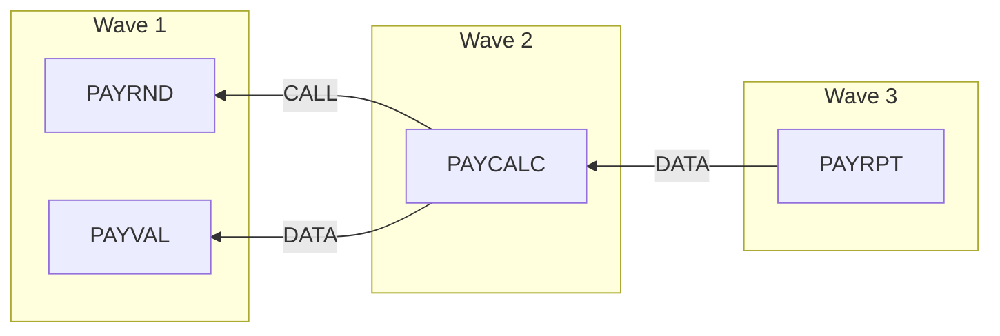

# Modernisation wave plan (proposal): industry-legacy-cobol

> **Proposal for human review.** This plan is computed mechanically from dependencies and metrics extracted from the code. It does not know business priorities, team capacity, cut-over windows or the chosen approach (rewrite, rehost, strangler, parallel run). People decide; every figure below cites the code it comes from.
>
> Source: 7 files analysed, source fingerprint sha256:5786adeb80741427.

## 1. How the plan is computed

> Dependency: program A depends on B when A CALLs B (static CALL or CICS LINK/XCTL with a literal), or when A reads a data set that B writes, directly or through utility steps without source (such as SORT).
>
> Wave: programs with no dependency on other analysed programs are in wave 1; any other program is one wave after the latest program it depends on. Programs in a dependency cycle form one group and move together.
>
> Inside a wave, groups are ordered by risk score, lowest first (a candidate pilot comes first).
>
> Risk score: the sum of the points in the risk factor table (section 7). Bands: 0-3 low, 4-7 medium, 8 and above high.
>
> Clusters: programs connected by CALL or data dependencies; candidate units to migrate or test together. Shared copybooks are listed as coupling but do not join clusters.

## 2. Waves

> Arrows point from a program to what it depends on. Boxes are grouped by wave.

### 2.1 Wave 1

| # | Program | Risk | Score | Statements | Reasons | Source |
| --- | --- | --- | --- | --- | --- | --- |
| 1 | `PAYRND` | low | 1 | 20 | no dependency on other analysed programs needed by PAYCALC | `source/cobol/PAYRND.cbl:1` |
| 2 | `PAYVAL` | low | 3 | 69 | no dependency on other analysed programs needed by PAYCALC | `source/cobol/PAYVAL.cbl:1` |

### 2.2 Wave 2

| # | Program | Risk | Score | Statements | Reasons | Source |
| --- | --- | --- | --- | --- | --- | --- |
| 1 | `PAYCALC` | low | 3 | 92 | depends on PAYRND (CALL), wave 1 depends on PAYVAL (DATA), wave 1 needed by PAYRPT | `source/cobol/PAYCALC.cbl:1` `source/cobol/PAYCALC.cbl:140` `source/cobol/PAYCALC.cbl:147` `source/cobol/PAYCALC.cbl:155` `source/cobol/PAYCALC.cbl:158` `source/cobol/PAYCALC.cbl:161` `source/cobol/PAYCALC.cbl:178` `source/cobol/PAYCALC.cbl:181` +6 |

### 2.3 Wave 3

| # | Program | Risk | Score | Statements | Reasons | Source |
| --- | --- | --- | --- | --- | --- | --- |
| 1 | `PAYRPT` | low | 2 | 133 | depends on PAYCALC (DATA), wave 2 | `source/cobol/PAYRPT.cbl:1` `source/jcl/PY01MNTH.jcl:38` `source/jcl/PY01MNTH.jcl:46` |

## 3. Dependencies

| Program | Kind | Depends on | Via data sets | Source |
| --- | --- | --- | --- | --- |
| `PAYCALC` | CALL | `PAYRND` |  | `source/cobol/PAYCALC.cbl:140` `source/cobol/PAYCALC.cbl:147` `source/cobol/PAYCALC.cbl:155` `source/cobol/PAYCALC.cbl:158` `source/cobol/PAYCALC.cbl:161` `source/cobol/PAYCALC.cbl:178` `source/cobol/PAYCALC.cbl:181` `source/cobol/PAYCALC.cbl:184` +1 |
| `PAYCALC` | DATA | `PAYVAL` | PY01MNTH/&&VALID → PY01MNTH/&&SORTED | `source/jcl/PY01MNTH.jcl:19` `source/jcl/PY01MNTH.jcl:26` `source/jcl/PY01MNTH.jcl:27` `source/jcl/PY01MNTH.jcl:37` |
| `PAYRPT` | DATA | `PAYCALC` | KZP.PY01.PAYCALC.M202609 | `source/jcl/PY01MNTH.jcl:38` `source/jcl/PY01MNTH.jcl:46` |

## 4. Cycles (strongly connected components)

No dependency cycles.

## 5. Clusters (candidate migration units)

- Cluster 1: PAYCALC, PAYRND, PAYRPT, PAYVAL `source/cobol/PAYCALC.cbl:1` `source/cobol/PAYRND.cbl:1` `source/cobol/PAYRPT.cbl:1` `source/cobol/PAYVAL.cbl:1`

## 6. Coupling between programs

| Programs | CALL sites | Data sets passed | Shared copybooks | Weight (3×CALL + 2×data set + copybook) | Source |
| --- | --- | --- | --- | --- | --- |
| `PAYCALC` ↔ `PAYRND` | 9 |  |  | 27 | `source/cobol/PAYCALC.cbl:140` `source/cobol/PAYCALC.cbl:147` `source/cobol/PAYCALC.cbl:155` `source/cobol/PAYCALC.cbl:158` `source/cobol/PAYCALC.cbl:161` `source/cobol/PAYCALC.cbl:178` `source/cobol/PAYCALC.cbl:181` `source/cobol/PAYCALC.cbl:184` +1 |
| `PAYCALC` ↔ `PAYVAL` | 0 | PY01MNTH/&&SORTED, PY01MNTH/&&VALID | EMPREC | 5 | `source/cobol/PAYCALC.cbl:43` `source/cobol/PAYVAL.cbl:32` `source/jcl/PY01MNTH.jcl:19` `source/jcl/PY01MNTH.jcl:26` `source/jcl/PY01MNTH.jcl:27` `source/jcl/PY01MNTH.jcl:37` |
| `PAYCALC` ↔ `PAYRPT` | 0 | KZP.PY01.PAYCALC.M202609 | PAYREC | 3 | `source/cobol/PAYCALC.cbl:45` `source/cobol/PAYRPT.cbl:24` `source/jcl/PY01MNTH.jcl:38` `source/jcl/PY01MNTH.jcl:46` |

## 7. Risk factors

| Program | Factor | Count | Points | Source |
| --- | --- | --- | --- | --- |
| `PAYCALC` | Size (statements; >50: 1, >200: 2) | 92 | 1 | `source/cobol/PAYCALC.cbl:1` |
| `PAYCALC` | Decision points (IF/WHEN/SEARCH/UNTIL; 1 per 10, max 4) | 10 | 1 | `source/cobol/PAYCALC.cbl:1` |
| `PAYCALC` | Writes data read by other programs (1 per data set, max 3) | 1 | 1 | `source/jcl/PY01MNTH.jcl:38` |
| `PAYRND` | Size (statements; >50: 1, >200: 2) | 20 | 0 | `source/cobol/PAYRND.cbl:1` |
| `PAYRND` | Decision points (IF/WHEN/SEARCH/UNTIL; 1 per 10, max 4) | 4 | 0 | `source/cobol/PAYRND.cbl:1` |
| `PAYRND` | Called by other programs (1 each, max 3) | 1 | 1 | `source/cobol/PAYCALC.cbl:140` `source/cobol/PAYCALC.cbl:147` `source/cobol/PAYCALC.cbl:155` `source/cobol/PAYCALC.cbl:158` `source/cobol/PAYCALC.cbl:161` `source/cobol/PAYCALC.cbl:178` +3 |
| `PAYRPT` | Size (statements; >50: 1, >200: 2) | 133 | 1 | `source/cobol/PAYRPT.cbl:1` |
| `PAYRPT` | Decision points (IF/WHEN/SEARCH/UNTIL; 1 per 10, max 4) | 12 | 1 | `source/cobol/PAYRPT.cbl:1` |
| `PAYVAL` | Size (statements; >50: 1, >200: 2) | 69 | 1 | `source/cobol/PAYVAL.cbl:1` |
| `PAYVAL` | Decision points (IF/WHEN/SEARCH/UNTIL; 1 per 10, max 4) | 12 | 1 | `source/cobol/PAYVAL.cbl:1` |
| `PAYVAL` | Writes data read by other programs (1 per data set, max 3) | 1 | 1 | `source/jcl/PY01MNTH.jcl:19` |

## 8. Size and complexity

| Program | Paragraphs | Statements | Decisions | GO TO | Programs called | Called by | Data sets/tables | Copybooks | Rule candidates | Source |
| --- | --- | --- | --- | --- | --- | --- | --- | --- | --- | --- |
| `PAYCALC` | 9 | 92 | 10 | 0 | 1 | 0 | 2 | 2 | 40 | `source/cobol/PAYCALC.cbl:1` |
| `PAYRND` | 3 | 20 | 4 | 0 | 0 | 1 | 0 | 0 | 9 | `source/cobol/PAYRND.cbl:1` |
| `PAYRPT` | 13 | 133 | 12 | 0 | 0 | 0 | 2 | 1 | 34 | `source/cobol/PAYRPT.cbl:1` |
| `PAYVAL` | 8 | 69 | 12 | 0 | 0 | 0 | 3 | 1 | 25 | `source/cobol/PAYVAL.cbl:1` |

## 9. Outside the plan (no source)

- `SORT`: program without source `source/jcl/PY01MNTH.jcl:25`

> These are called or run but have no source in the analysed folder. Decide for each: system utility to replace, vendor routine to keep, or source still to be supplied.

## 10. Open questions that can change the plan

> Open questions found in the code: 1 (dynamic calls, missing copybooks, unbound files, ...). Each can hide a dependency. They are listed with their source lines in the coverage section of the design document; the ones that affect a planned program are below.

None that affect a planned program.
