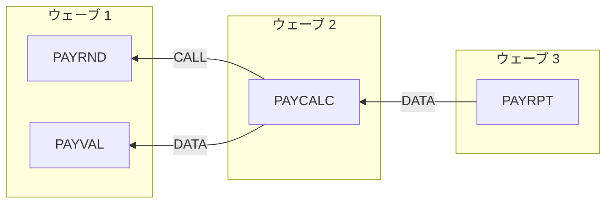

# モダナイゼーション移行ウェーブ計画（案）：industry-legacy-cobol

> **本書は担当者によるレビューを前提とした提案です。** コードから抽出した依存関係と指標をもとに機械的に算出しており、業務上の優先度、体制、切替時期、移行方式（リライト、リホスト、ストラングラー、並行稼働など）は考慮していません。判断は担当者が行います。以下の数値にはすべて根拠となるソース位置を付けています。
>
> 解析対象：7 ファイル、ソース指紋 sha256:5786adeb80741427

## 1. 算出方法

> 依存関係：プログラム A が B を CALL する場合（静的 CALL、またはリテラル指定の CICS LINK／XCTL）、または B が出力するデータセットを A が読む場合（直接、またはソースのないユーティリティステップ（SORT など）を経由）、A は B に依存するとみなします。
>
> ウェーブ：解析対象の他プログラムに依存しないプログラムをウェーブ 1 とし、それ以外は依存先のうち最も遅いウェーブの次のウェーブとします。依存関係が循環するプログラムは 1 グループとして同時に移行します。
>
> 同じウェーブ内では、リスクスコアの低いグループから順に並べます（先頭がパイロット候補）。
>
> リスクスコア：リスク要因表（第 7 章）の点数の合計です。区分：0〜3 低、4〜7 中、8 以上 高。
>
> クラスタ：CALL またはデータの依存でつながるプログラムの集合で、まとめて移行・テストする単位の候補です。共有コピーブックは結合度として示しますが、クラスタの判定には使いません。

## 2. ウェーブ一覧

> 矢印はプログラムから依存先に向かいます。枠はウェーブ単位です。

### 2.1 ウェーブ 1

| 順 | プログラム | リスク | スコア | 文数 | 理由 | 根拠 |
| --- | --- | --- | --- | --- | --- | --- |
| 1 | `PAYRND` | 低 | 1 | 20 | 解析対象の他プログラムへの依存なし PAYCALC が依存 | `source/cobol/PAYRND.cbl:1` |
| 2 | `PAYVAL` | 低 | 3 | 69 | 解析対象の他プログラムへの依存なし PAYCALC が依存 | `source/cobol/PAYVAL.cbl:1` |

### 2.2 ウェーブ 2

| 順 | プログラム | リスク | スコア | 文数 | 理由 | 根拠 |
| --- | --- | --- | --- | --- | --- | --- |
| 1 | `PAYCALC` | 低 | 3 | 92 | PAYRND に依存（CALL）、ウェーブ 1 PAYVAL に依存（DATA）、ウェーブ 1 PAYRPT が依存 | `source/cobol/PAYCALC.cbl:1` `source/cobol/PAYCALC.cbl:140` `source/cobol/PAYCALC.cbl:147` `source/cobol/PAYCALC.cbl:155` `source/cobol/PAYCALC.cbl:158` `source/cobol/PAYCALC.cbl:161` `source/cobol/PAYCALC.cbl:178` `source/cobol/PAYCALC.cbl:181` +6 |

### 2.3 ウェーブ 3

| 順 | プログラム | リスク | スコア | 文数 | 理由 | 根拠 |
| --- | --- | --- | --- | --- | --- | --- |
| 1 | `PAYRPT` | 低 | 2 | 133 | PAYCALC に依存（DATA）、ウェーブ 2 | `source/cobol/PAYRPT.cbl:1` `source/jcl/PY01MNTH.jcl:38` `source/jcl/PY01MNTH.jcl:46` |

## 3. 依存関係

| プログラム | 種別 | 依存先 | 経由データセット | 根拠 |
| --- | --- | --- | --- | --- |
| `PAYCALC` | CALL | `PAYRND` |  | `source/cobol/PAYCALC.cbl:140` `source/cobol/PAYCALC.cbl:147` `source/cobol/PAYCALC.cbl:155` `source/cobol/PAYCALC.cbl:158` `source/cobol/PAYCALC.cbl:161` `source/cobol/PAYCALC.cbl:178` `source/cobol/PAYCALC.cbl:181` `source/cobol/PAYCALC.cbl:184` +1 |
| `PAYCALC` | DATA | `PAYVAL` | PY01MNTH/&&VALID → PY01MNTH/&&SORTED | `source/jcl/PY01MNTH.jcl:19` `source/jcl/PY01MNTH.jcl:26` `source/jcl/PY01MNTH.jcl:27` `source/jcl/PY01MNTH.jcl:37` |
| `PAYRPT` | DATA | `PAYCALC` | KZP.PY01.PAYCALC.M202609 | `source/jcl/PY01MNTH.jcl:38` `source/jcl/PY01MNTH.jcl:46` |

## 4. 循環（強連結成分）

依存関係の循環はありません。

## 5. クラスタ（移行単位の候補）

- クラスタ 1：PAYCALC, PAYRND, PAYRPT, PAYVAL `source/cobol/PAYCALC.cbl:1` `source/cobol/PAYRND.cbl:1` `source/cobol/PAYRPT.cbl:1` `source/cobol/PAYVAL.cbl:1`

## 6. プログラム間の結合度

| プログラム | CALL 箇所 | 受け渡しデータセット | 共有コピーブック | 重み（3×CALL＋2×データセット＋コピーブック） | 根拠 |
| --- | --- | --- | --- | --- | --- |
| `PAYCALC` ↔ `PAYRND` | 9 |  |  | 27 | `source/cobol/PAYCALC.cbl:140` `source/cobol/PAYCALC.cbl:147` `source/cobol/PAYCALC.cbl:155` `source/cobol/PAYCALC.cbl:158` `source/cobol/PAYCALC.cbl:161` `source/cobol/PAYCALC.cbl:178` `source/cobol/PAYCALC.cbl:181` `source/cobol/PAYCALC.cbl:184` +1 |
| `PAYCALC` ↔ `PAYVAL` | 0 | PY01MNTH/&&SORTED, PY01MNTH/&&VALID | EMPREC | 5 | `source/cobol/PAYCALC.cbl:43` `source/cobol/PAYVAL.cbl:32` `source/jcl/PY01MNTH.jcl:19` `source/jcl/PY01MNTH.jcl:26` `source/jcl/PY01MNTH.jcl:27` `source/jcl/PY01MNTH.jcl:37` |
| `PAYCALC` ↔ `PAYRPT` | 0 | KZP.PY01.PAYCALC.M202609 | PAYREC | 3 | `source/cobol/PAYCALC.cbl:45` `source/cobol/PAYRPT.cbl:24` `source/jcl/PY01MNTH.jcl:38` `source/jcl/PY01MNTH.jcl:46` |

## 7. リスク要因

| プログラム | 要因 | 件数 | 点数 | 根拠 |
| --- | --- | --- | --- | --- |
| `PAYCALC` | 規模（文数。50 超：1、200 超：2） | 92 | 1 | `source/cobol/PAYCALC.cbl:1` |
| `PAYCALC` | 判定数（IF/WHEN/SEARCH/UNTIL。10 件ごとに 1、上限 4） | 10 | 1 | `source/cobol/PAYCALC.cbl:1` |
| `PAYCALC` | 他プログラムが読むデータの出力（1 データセット 1、上限 3） | 1 | 1 | `source/jcl/PY01MNTH.jcl:38` |
| `PAYRND` | 規模（文数。50 超：1、200 超：2） | 20 | 0 | `source/cobol/PAYRND.cbl:1` |
| `PAYRND` | 判定数（IF/WHEN/SEARCH/UNTIL。10 件ごとに 1、上限 4） | 4 | 0 | `source/cobol/PAYRND.cbl:1` |
| `PAYRND` | 他プログラムからの CALL（1 本 1、上限 3） | 1 | 1 | `source/cobol/PAYCALC.cbl:140` `source/cobol/PAYCALC.cbl:147` `source/cobol/PAYCALC.cbl:155` `source/cobol/PAYCALC.cbl:158` `source/cobol/PAYCALC.cbl:161` `source/cobol/PAYCALC.cbl:178` +3 |
| `PAYRPT` | 規模（文数。50 超：1、200 超：2） | 133 | 1 | `source/cobol/PAYRPT.cbl:1` |
| `PAYRPT` | 判定数（IF/WHEN/SEARCH/UNTIL。10 件ごとに 1、上限 4） | 12 | 1 | `source/cobol/PAYRPT.cbl:1` |
| `PAYVAL` | 規模（文数。50 超：1、200 超：2） | 69 | 1 | `source/cobol/PAYVAL.cbl:1` |
| `PAYVAL` | 判定数（IF/WHEN/SEARCH/UNTIL。10 件ごとに 1、上限 4） | 12 | 1 | `source/cobol/PAYVAL.cbl:1` |
| `PAYVAL` | 他プログラムが読むデータの出力（1 データセット 1、上限 3） | 1 | 1 | `source/jcl/PY01MNTH.jcl:19` |

## 8. 規模・複雑度

| プログラム | 段落数 | 文数 | 判定数 | GO TO | 呼出し先 | 呼出し元 | データセット／テーブル | コピーブック | ルール候補 | 根拠 |
| --- | --- | --- | --- | --- | --- | --- | --- | --- | --- | --- |
| `PAYCALC` | 9 | 92 | 10 | 0 | 1 | 0 | 2 | 2 | 40 | `source/cobol/PAYCALC.cbl:1` |
| `PAYRND` | 3 | 20 | 4 | 0 | 0 | 1 | 0 | 0 | 9 | `source/cobol/PAYRND.cbl:1` |
| `PAYRPT` | 13 | 133 | 12 | 0 | 0 | 0 | 2 | 1 | 34 | `source/cobol/PAYRPT.cbl:1` |
| `PAYVAL` | 8 | 69 | 12 | 0 | 0 | 0 | 3 | 1 | 25 | `source/cobol/PAYVAL.cbl:1` |

## 9. 計画対象外（ソースなし）

- `SORT`: ソースのないプログラム `source/jcl/PY01MNTH.jcl:25`

> 呼び出し・実行されているものの、解析対象フォルダにソースがありません。システムユーティリティとして置き換えるか、製品ルーチンとして残すか、ソースを追加提供するかを個別に判断してください。

## 10. 計画に影響しうる要確認事項

> コードから 1 件の要確認事項（動的 CALL、コピーブック未検出、DD 未対応のファイルなど）を検出しました。いずれも依存関係の見落としにつながる可能性があります。全件は設計書のカバレッジの章に根拠付きで記載しています。計画対象のプログラムに関わるものを以下に示します。

計画対象のプログラムに関わるものはありません。
